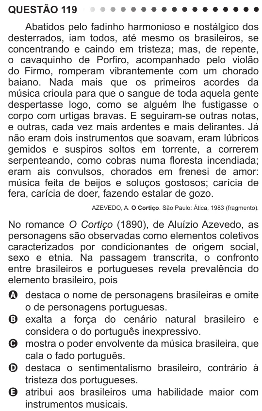

Texto extraído (pode conter ruído)

QUESTÃO 119  
Abatidos pelo fadinho harmonioso e nostálgico dos  
desterrados, iam todos, até mesmo os brasileiros, se  
concentrando e caindo em tristeza; mas, de repente,  
o cavaquinho de Porfiro, acompanhado pelo violão  
do Firmo, romperam vibrantemente com um chorado  
baiano. Nada mais que os primeiros acordes da  
música crioula para que o sangue de toda aquela gente  
despertasse logo, como se alguém lhe fustigasse o  
corpo com urtigas bravas. E seguiram-se outras notas,  
e outras, cada vez mais ardentes e mais delirantes. Já  
não eram dois instrumentos que soavam, eram lúbricos  
gemidos e suspiros soltos em torrente, a correrem  
serpenteando, como cobras numa floresta incendiada;  
eram ais convulsos, chorados em frenesi de amor:  
música feita de beijos e soluços gostosos; carícia de  
fera, carícia de doer, fazendo estalar de gozo.  
AZEVEDO, A. O Cortiço. São Paulo: Ática, 1983 (fragmento).  
No romance O Cortiço (1890), de Aluízio Azevedo, as  
personagens são observadas como elementos coletivos  
caracterizados por condicionantes de origem social,  
sexo e etnia. Na passagem transcrita, o confronto  
entre brasileiros e portugueses revela prevalência do  
elemento brasileiro, pois  
A destaca o nome de personagens brasileiras e omite  
o de personagens portuguesas.  
B exalta a força do cenário natural brasileiro e  
considera o do português inexpressivo.  
C mostra o poder envolvente da música brasileira, que  
cala o fado português.  
D destaca o sentimentalismo brasileiro, contrário à  
tristeza dos portugueses.  
E atribui aos brasileiros uma habilidade maior com  
instrumentos musicais.

