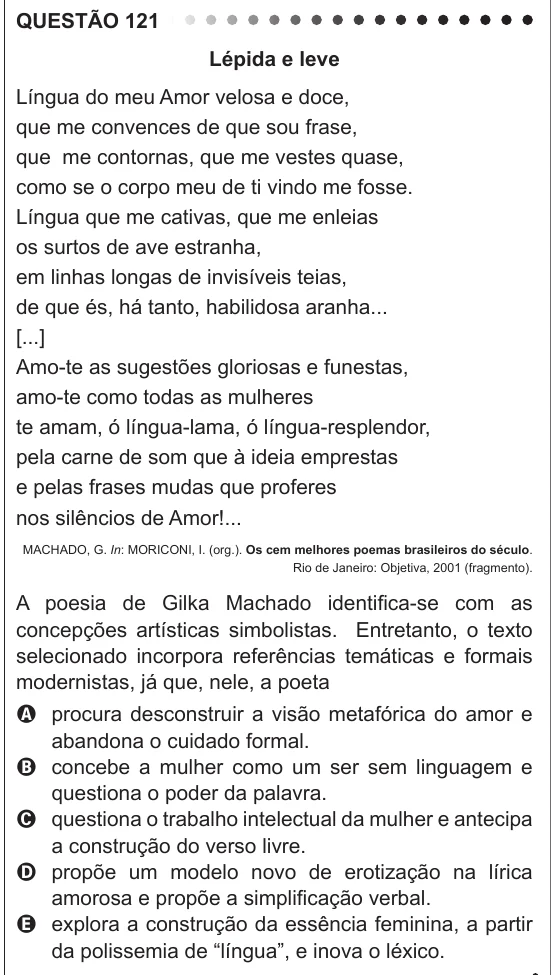

Texto extraído (pode conter ruído)

QUESTÃO 121  
Lépida e leve  
Língua do meu Amor velosa e doce,  
que me convences de que sou frase,  
que me contornas, que me vestes quase,  
como se o corpo meu de ti vindo me fosse.  
Língua que me cativas, que me enleias  
os surtos de ave estranha,  
em linhas longas de invisíveis teias,  
de que és, há tanto, habilidosa aranha...  
[...]  
Amo-te as sugestões gloriosas e funestas,  
amo-te como todas as mulheres  
te amam, ó língua-lama, ó língua-resplendor,  
pela carne de som que à ideia emprestas  
e pelas frases mudas que proferes  
nos silêncios de Amor!...  
MACHADO, G. In: MORICONI, I. (org.). Os cem melhores poemas brasileiros do século.  
Rio de Janeiro: Objetiva, 2001 (fragmento).  
A poesia de Gilka Machado identifica-se com as  
concepções artísticas simbolistas. Entretanto, o texto  
selecionado incorpora referências temáticas e formais  
modernistas, já que, nele, a poeta  
A procura desconstruir a visão metafórica do amor e  
abandona o cuidado formal.  
B concebe a mulher como um ser sem linguagem e  
questiona o poder da palavra.  
C questiona o trabalho intelectual da mulher e antecipa  
a construção do verso livre.  
D propõe um modelo novo de erotização na lírica  
amorosa e propõe a simplificação verbal.  
E explora a construção da essência feminina, a partir  
da polissemia de “língua”, e inova o léxico.

