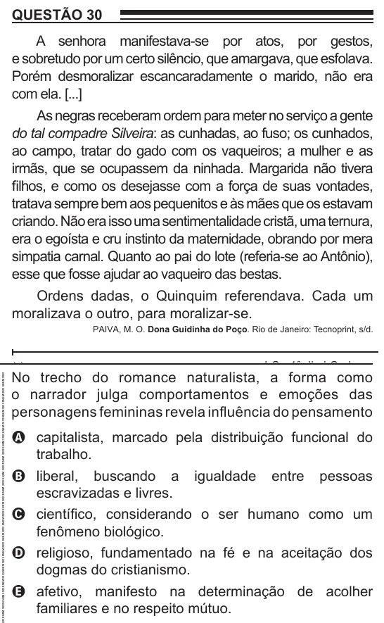

Texto extraído (pode conter ruído)

QUESTÃO 30  
A senhora manifestava-se por atos, por gestos,  
e sobretudo por um certo silêncio, que amargava, que esfolava.  
Porém desmoralizar escancaradamente o marido, não era  
com ela. [...]  
As negras receberam ordem para meter no serviço a gente  
do tal compadre Silveira: as cunhadas, ao fuso; os cunhados,  
ao campo, tratar do gado com os vaqueiros; a mulher e as  
irmãs, que se ocupassem da ninhada. Margarida não tivera  
filhos, e como os desejasse com a força de suas vontades,  
tratava sempre bem aos pequenitos e às mães que os estavam  
criando. Não era isso uma sentimentalidade cristã, uma ternura,  
era o egoísta e cru instinto da maternidade, obrando por mera  
simpatia carnal. Quanto ao pai do lote (referia-se ao Antônio),  
esse que fosse ajudar ao vaqueiro das bestas.  
Ordens dadas, o Quinquim referendava. Cada um  
moralizava o outro, para moralizar-se.  
PAIVA, M. O. Dona Guidinha do Poço. Rio de Janeiro: Tecnoprint, s/d.  
No trecho do romance naturalista, a forma como  
o narrador julga comportamentos e emoções das  
personagens femininas revela influência do pensamento  
A capitalista, marcado pela distribuição funcional do  
trabalho.  
B liberal, buscando a igualdade entre pessoas  
escravizadas e livres.  
C científico, considerando o ser humano como um  
fenômeno biológico.  
D religioso, fundamentado na fé e na aceitação dos  
dogmas do cristianismo.  
E afetivo, manifesto na determinação de acolher  
familiares e no respeito mútuo.

