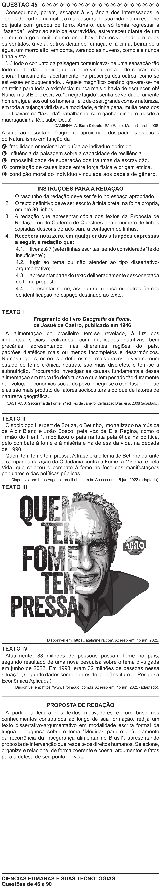

Texto extraído (pode conter ruído)

QUESTÃO 45  
Conseguindo, porém, escapar à vigilância dos interessados, e  
depois de curtir uma noite, a mais escura de sua vida, numa espécie  
de jaula com grades de ferro, Amaro, que só temia regressar à  
“fazenda”, voltar ao seio da escravidão, estremeceu diante de um  
rio muito largo e muito calmo, onde havia barcos vogando em todos  
os sentidos, à vela, outros deitando fumaça, e lá cima, beirando a  
água, um morro alto, em ponta, varando as nuvens, como ele nunca  
tinha visto...  
[...] todo o conjunto da paisagem comunicava-lhe uma sensação tão  
forte de liberdade e vida, que até lhe vinha vontade de chorar, mas  
chorar francamente, abertamente, na presença dos outros, como se  
estivesse enlouquecendo... Aquele magnífico cenário gravara-se-lhe  
na retina para toda a existência; nunca mais o havia de esquecer, oh!  
Nunca mais! Ele, o escravo, “o negro fugido”, sentia-se verdadeiramente  
homem, igual aos outros homens, feliz de o ser, grande como a natureza,  
em toda a pujança viril da sua mocidade, e tinha pena, muita pena dos  
que ficavam na “fazenda” trabalhando, sem ganhar dinheiro, desde a  
madrugadinha té... sabe Deus!  
CAMINHA, A. Bom Crioulo. São Paulo: Martin Claret, 2008.  
A situação descrita no fragmento aproxima-o dos padrões estéticos  
do Naturalismo em função da  
A fragilidade emocional atribuída ao indivíduo oprimido.  
B influência da paisagem sobre a capacidade de resiliência.  
C impossibilidade de superação dos traumas da escravidão.  
D correlação de causalidade entre força física e origem étnica.  
E condição moral do indivíduo vinculada aos papéis de gênero.  
INSTRUÇÕES PARA A REDAÇÃO  
1. O rascunho da redação deve ser feito no espaço apropriado.  
2. O texto definitivo deve ser escrito à tinta preta, na folha própria,  
em até 30 linhas.  
3. A redação que apresentar cópia dos textos da Proposta de  
Redação ou do Caderno de Questões terá o número de linhas  
copiadas desconsiderado para a contagem de linhas.  
4. Receberá nota zero, em qualquer das situações expressas  
a seguir, a redação que:  
  4.1. tiver até 7 (sete) linhas escritas, sendo considerada “texto  
insuficiente”;  
    
4.2. fugir ao tema ou não atender ao tipo dissertativo-  
argumentativo;  
  4.3. apresentar parte do texto deliberadamente desconectada  
do tema proposto;  
  4.4. apresentar nome, assinatura, rubrica ou outras formas  
de identificação no espaço destinado ao texto.  
TEXTO I  
Fragmento do livro Geografia da Fome,  
de Josué de Castro, publicado em 1946  
A alimentação do brasileiro tem-se revelado, à luz dos  
inquéritos sociais realizados, com qualidades nutritivas bem  
precárias, apresentando, nas diferentes regiões do país,  
padrões dietéticos mais ou menos incompletos e desarmônicos.  
Numas regiões, os erros e defeitos são mais graves, e vive-se num  
estado de fome crônica; noutras, são mais discretos, e tem-se a  
subnutrição. Procurando investigar as causas fundamentais dessa  
alimentação em regra tão defeituosa e que tem pesado tão duramente  
na evolução econômico-social do povo, chega-se à conclusão de que  
elas são mais produto de fatores socioculturais do que de fatores de  
natureza geográfica.  
CASTRO, J. Geografia da Fome. 9ª ed. Rio de Janeiro: Civilização Brasileira, 2008 (adaptado).  
TEXTO II  
O sociólogo Herbert de Souza, o Betinho, imortalizado na música  
de Aldir Blanc e João Bosco, pela voz de Elis Regina, como o  
“irmão do Henfil”, mobilizou o país na luta pela ética na política,  
pelo combate à fome e à miséria e na defesa da vida, na década  
de 1990.  
Quem tem fome tem pressa. A frase era o lema de Betinho durante  
a campanha da Ação da Cidadania contra a Fome, a Miséria, e pela  
Vida, que colocou o combate à fome no foco das manifestações  
populares e das políticas públicas.  
Disponível em: https://agenciabrasil.ebc.com.br. Acesso em: 15 jun. 2022 (adaptado).  
TEXTO III  
DA CIDADANIA  
Disponível em: https://atalmineira.com. Acesso em: 15 jun. 2022.  
TEXTO IV  
Atualmente, 33 milhões de pessoas passam fome no país,  
segundo resultado de uma nova pesquisa sobre o tema divulgada  
em junho de 2022. Em 1993, eram 32 milhões de pessoas nessa  
situação, segundo dados semelhantes do Ipea (Instituto de Pesquisa  
Econômica Aplicada).  
Disponível em: https://www1.folha.uol.com.br. Acesso em: 15 jun. 2022 (adaptado).  
PROPOSTA DE REDAÇÃO  
A partir da leitura dos textos motivadores e com base nos  
conhecimentos construídos ao longo de sua formação, redija um  
texto dissertativo-argumentativo em modalidade escrita formal da  
língua portuguesa sobre o tema “Medidas para o enfrentamento  
da recorrência da insegurança alimentar no Brasil”, apresentando  
proposta de intervenção que respeite os direitos humanos. Selecione,  
organize e relacione, de forma coerente e coesa, argumentos e fatos  
para a defesa de seu ponto de vista.  
CIÊNCIAS HUMANAS E SUAS TECNOLOGIAS

