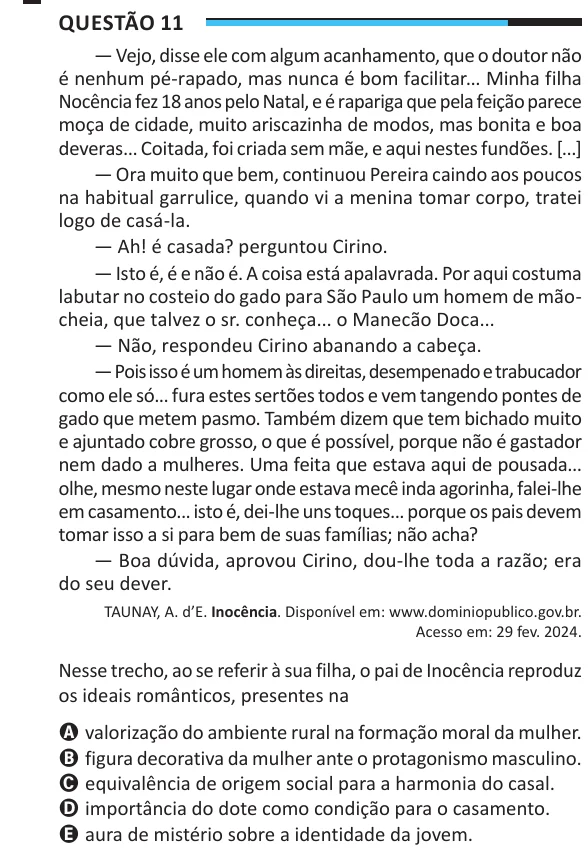

Texto extraído (pode conter ruído)

Questão 11  
— Vejo, disse ele com algum acanhamento, que o doutor não  
é nenhum pé-rapado, mas nunca é bom facilitar... Minha filha  
Nocência fez 18 anos pelo Natal, e é rapariga que pela feição parece  
moça de cidade, muito ariscazinha de modos, mas bonita e boa  
deveras... Coitada, foi criada sem mãe, e aqui nestes fundões. [...]  
— Ora muito que bem, continuou Pereira caindo aos poucos  
na habitual garrulice, quando vi a menina tomar corpo, tratei  
logo de casá-la.  
— Ah! é casada? perguntou Cirino.  
— Isto é, é e não é. A coisa está apalavrada. Por aqui costuma  
labutar no costeio do gado para São Paulo um homem de mão-  
cheia, que talvez o sr. conheça... o Manecão Doca...  
— Não, respondeu Cirino abanando a cabeça.  
— Pois isso é um homem às direitas, desempenado e trabucador  
como ele só... fura estes sertões todos e vem tangendo pontes de  
gado que metem pasmo. Também dizem que tem bichado muito  
e ajuntado cobre grosso, o que é possível, porque não é gastador  
nem dado a mulheres. Uma feita que estava aqui de pousada...  
olhe, mesmo neste lugar onde estava mecê inda agorinha, falei-lhe  
em casamento... isto é, dei-lhe uns toques... porque os pais devem  
tomar isso a si para bem de suas famílias; não acha?  
— Boa dúvida, aprovou Cirino, dou-lhe toda a razão; era  
do seu dever.  
TAUNAY, A. d’E. Inocência. Disponível em: www.dominiopublico.gov.br.  
Acesso em: 29 fev. 2024.  
Nesse trecho, ao se referir à sua filha, o pai de Inocência reproduz  
os ideais românticos, presentes na  
A valorização do ambiente rural na formação moral da mulher.  
B figura decorativa da mulher ante o protagonismo masculino.  
C equivalência de origem social para a harmonia do casal.  
D importância do dote como condição para o casamento.  
E aura de mistério sobre a identidade da jovem.

