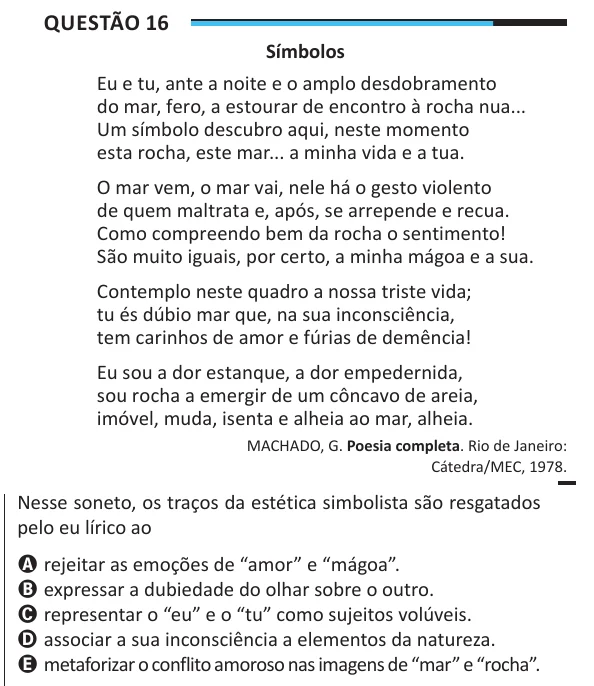

Texto extraído (pode conter ruído)

Questão 16  
Símbolos  
Eu e tu, ante a noite e o amplo desdobramento  
do mar, fero, a estourar de encontro à rocha nua...  
Um símbolo descubro aqui, neste momento  
esta rocha, este mar... a minha vida e a tua.  
O mar vem, o mar vai, nele há o gesto violento  
de quem maltrata e, após, se arrepende e recua.  
Como compreendo bem da rocha o sentimento!  
São muito iguais, por certo, a minha mágoa e a sua.  
Contemplo neste quadro a nossa triste vida;  
tu és dúbio mar que, na sua inconsciência,  
tem carinhos de amor e fúrias de demência!  
Eu sou a dor estanque, a dor empedernida,  
sou rocha a emergir de um côncavo de areia,  
imóvel, muda, isenta e alheia ao mar, alheia.  
MACHADO, G. Poesia completa. Rio de Janeiro:  
Cátedra/MEC, 1978.  
Nesse soneto, os traços da estética simbolista são resgatados  
pelo eu lírico ao  
A rejeitar as emoções de “amor” e “mágoa”.  
B expressar a dubiedade do olhar sobre o outro.  
C representar o “eu” e o “tu” como sujeitos volúveis.  
D associar a sua inconsciência a elementos da natureza.  
E metaforizar o conflito amoroso nas imagens de “mar” e “rocha”.

