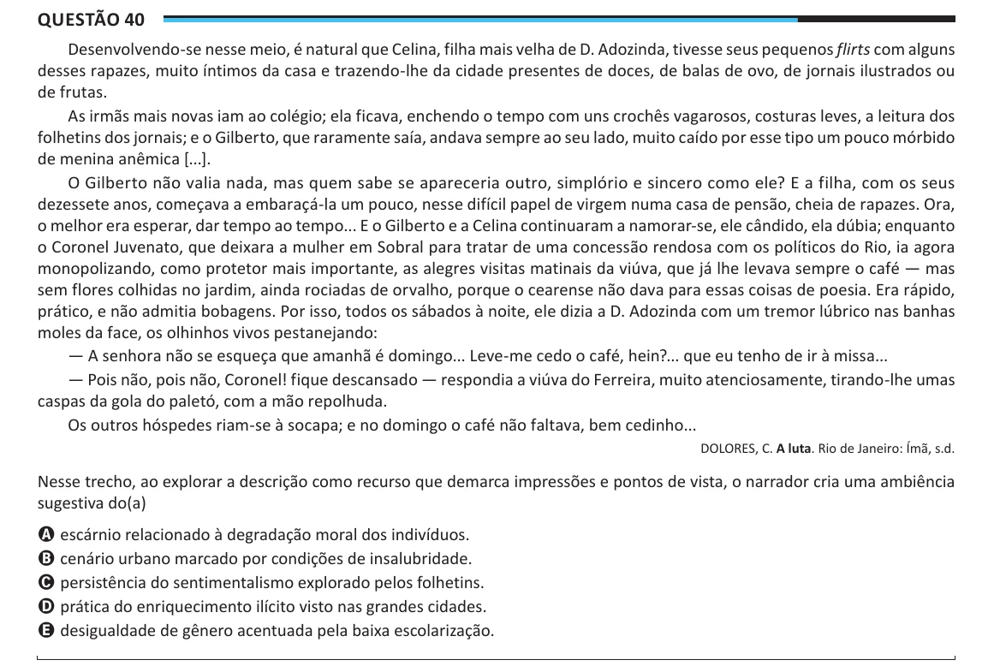

Texto extraído (pode conter ruído)

Questão 40  
Desenvolvendo-se nesse meio, é natural que Celina, filha mais velha de D. Adozinda, tivesse seus pequenos flirts com alguns  
desses rapazes, muito íntimos da casa e trazendo-lhe da cidade presentes de doces, de balas de ovo, de jornais ilustrados ou  
de frutas.  
As irmãs mais novas iam ao colégio; ela ficava, enchendo o tempo com uns crochês vagarosos, costuras leves, a leitura dos  
folhetins dos jornais; e o Gilberto, que raramente saía, andava sempre ao seu lado, muito caído por esse tipo um pouco mórbido  
de menina anêmica [...].  
O Gilberto não valia nada, mas quem sabe se apareceria outro, simplório e sincero como ele? E a filha, com os seus  
dezessete anos, começava a embaraçá-la um pouco, nesse difícil papel de virgem numa casa de pensão, cheia de rapazes. Ora,  
o melhor era esperar, dar tempo ao tempo... E o Gilberto e a Celina continuaram a namorar-se, ele cândido, ela dúbia; enquanto  
o Coronel Juvenato, que deixara a mulher em Sobral para tratar de uma concessão rendosa com os políticos do Rio, ia agora  
monopolizando, como protetor mais importante, as alegres visitas matinais da viúva, que já lhe levava sempre o café — mas  
sem flores colhidas no jardim, ainda rociadas de orvalho, porque o cearense não dava para essas coisas de poesia. Era rápido,  
prático, e não admitia bobagens. Por isso, todos os sábados à noite, ele dizia a D. Adozinda com um tremor lúbrico nas banhas  
moles da face, os olhinhos vivos pestanejando:  
— A senhora não se esqueça que amanhã é domingo... Leve-me cedo o café, hein?... que eu tenho de ir à missa...  
— Pois não, pois não, Coronel! fique descansado — respondia a viúva do Ferreira, muito atenciosamente, tirando-lhe umas  
caspas da gola do paletó, com a mão repolhuda.  
Os outros hóspedes riam-se à socapa; e no domingo o café não faltava, bem cedinho...  
DOLORES, C. A luta. Rio de Janeiro: Ímã, s.d.  
Nesse trecho, ao explorar a descrição como recurso que demarca impressões e pontos de vista, o narrador cria uma ambiência  
sugestiva do(a)  
A escárnio relacionado à degradação moral dos indivíduos.  
B cenário urbano marcado por condições de insalubridade.  
C persistência do sentimentalismo explorado pelos folhetins.  
D prática do enriquecimento ilícito visto nas grandes cidades.  
E desigualdade de gênero acentuada pela baixa escolarização.

