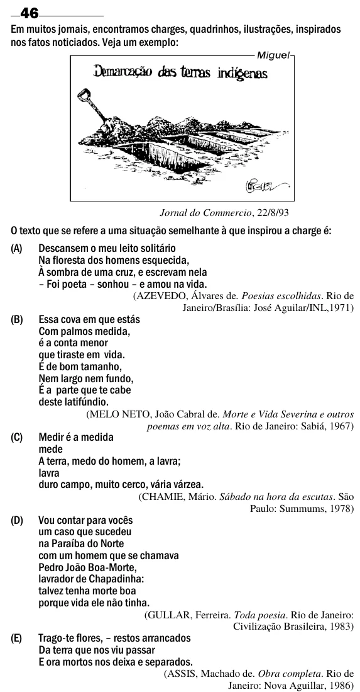

Texto extraído (pode conter ruído)

46  
Em muitos jornais, encontramos charges, quadrinhos, ilustrações, inspirados  
nos fatos noticiados. Veja um exemplo:  
Jornal do Commercio, 22/8/93  
O texto que se refere a uma situação semelhante à que inspirou a charge é:  
(A) Descansem o meu leito solitário  
Na floresta dos homens esquecida,  
À sombra de uma cruz, e escrevam nela  
– Foi poeta – sonhou – e amou na vida.  
(AZEVEDO, Álvares de. Poesias escolhidas. Rio de  
Janeiro/Brasília: José Aguilar/INL,1971)  
(B)  
Essa cova em que estás  
Com palmos medida,  
é a conta menor  
que tiraste em vida.  
É de bom tamanho,  
Nem largo nem fundo,  
É a parte que te cabe  
deste latifúndio.  
(MELO NETO, João Cabral de. Morte e Vida Severina e outros  
poemas em voz alta. Rio de Janeiro: Sabiá, 1967)  
(C)  
Medir é a medida  
mede  
A terra, medo do homem, a lavra;  
lavra  
duro campo, muito cerco, vária várzea.  
(CHAMIE, Mário. Sábado na hora da escutas. São  
Paulo: Summums, 1978)  
(D)  
Vou contar para vocês  
um caso que sucedeu  
na Paraíba do Norte  
com um homem que se chamava  
Pedro João Boa-Morte,  
lavrador de Chapadinha:  
talvez tenha morte boa  
porque vida ele não tinha.  
(GULLAR, Ferreira. Toda poesia. Rio de Janeiro:  
Civilização Brasileira, 1983)  
(E)  
Trago-te flores, – restos arrancados  
Da terra que nos viu passar  
E ora mortos nos deixa e separados.  
(ASSIS, Machado de. Obra completa. Rio de  
Janeiro: Nova Aguillar, 1986)

