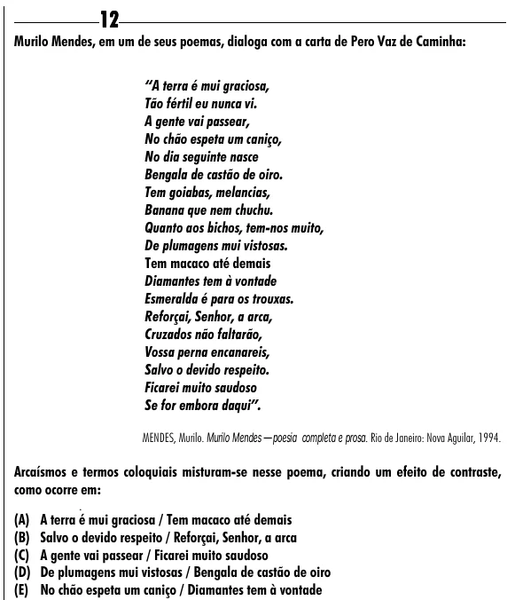

Texto extraído (pode conter ruído)

12  
Murilo Mendes, em um de seus poemas, dialoga com a carta de Pero Vaz de Caminha:  
“A terra é mui graciosa,  
Tão fértil eu nunca vi.  
A gente vai passear,  
No chão espeta um caniço,  
No dia seguinte nasce  
Bengala de castão de oiro.  
Tem goiabas, melancias,  
Banana que nem chuchu.  
Quanto aos bichos, tem-nos muito,  
De plumagens mui vistosas.  
Tem macaco até demais  
Diamantes tem à vontade  
Esmeralda é para os trouxas.  
Reforçai, Senhor, a arca,  
Cruzados não faltarão,  
Vossa perna encanareis,  
Salvo o devido respeito.  
Ficarei muito saudoso  
Se for embora daqui”.  
MENDES, Murilo. Murilo Mendes — poesia completa e prosa. Rio de Janeiro: Nova Aguilar, 1994.  
Arcaísmos e termos coloquiais misturam-se nesse poema, criando um efeito de contraste,  
como ocorre em:  
(A) A terra é mui graciosa / Tem macaco até demais  
(B) Salvo o devido respeito / Reforçai, Senhor, a arca  
(C) A gente vai passear / Ficarei muito saudoso  
(D) De plumagens mui vistosas / Bengala de castão de oiro  
(E) No chão espeta um caniço / Diamantes tem à vontade

