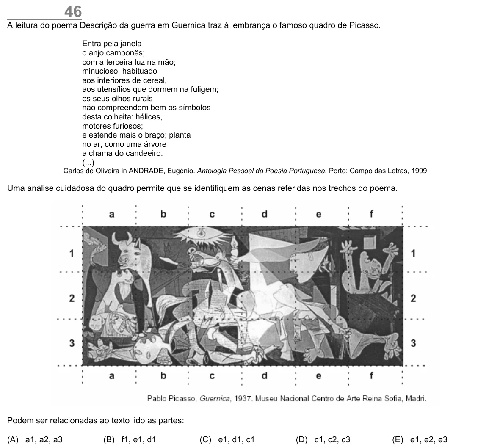

Texto extraído (pode conter ruído)

46  
A leitura do poema Descrição da guerra em Guernica traz à lembrança o famoso quadro de Picasso.  
Entra pela janela  
o anjo camponês;  
com a terceira luz na mão;  
minucioso, habituado  
aos interiores de cereal,  
aos utensílios que dormem na fuligem;  
os seus olhos rurais  
não compreendem bem os símbolos  
desta colheita: hélices,  
motores furiosos;  
e estende mais o braço; planta  
no ar, como uma árvore  
a chama do candeeiro.  
(...)  
Carlos de Oliveira in ANDRADE, Eugénio. Antologia Pessoal da Poesia Portuguesa. Porto: Campo das Letras, 1999.  
Uma análise cuidadosa do quadro permite que se identifiquem as cenas referidas nos trechos do poema.  
Podem ser relacionadas ao texto lido as partes:  
(A) a1, a2, a3  
(B) f1, e1, d1  
(C) e1, d1, c1  
(D) c1, c2, c3  
(E) e1, e2, e3

