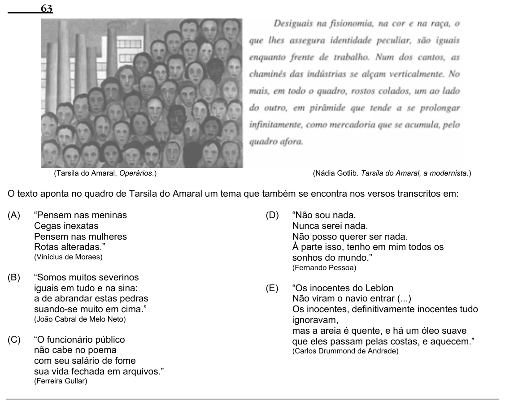

Texto extraído (pode conter ruído)

63  
(Tarsila do Amaral, Operários.)  
(Nádia Gotlib. Tarsila do Amaral, a modernista.)  
O texto aponta no quadro de Tarsila do Amaral um tema que também se encontra nos versos transcritos em:  
(A)  
“Pensem nas meninas  
(D)  
“Não sou nada.  
Cegas inexatas  
Nunca serei nada.  
Pensem nas mulheres  
Não posso querer ser nada.  
Rotas alteradas.”  
À parte isso, tenho em mim todos os  
(Vinícius de Moraes)  
sonhos do mundo.”  
(Fernando Pessoa)  
(B)  
“Somos muitos severinos  
iguais em tudo e na sina:  
(E)  
“Os inocentes do Leblon  
a de abrandar estas pedras  
Não viram o navio entrar (...)  
suando-se muito em cima.”  
Os inocentes, definitivamente inocentes tudo  
(João Cabral de Melo Neto)  
ignoravam,  
mas a areia é quente, e há um óleo suave  
(C)  
“O funcionário público  
que eles passam pelas costas, e aquecem.”  
não cabe no poema  
(Carlos Drummond de Andrade)  
com seu salário de fome  
sua vida fechada em arquivos.”  
(Ferreira Gullar)

