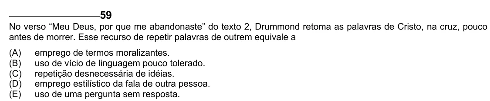

Texto extraído (pode conter ruído)

59  
No verso “Meu Deus, por que me abandonaste” do texto 2, Drummond retoma as palavras de Cristo, na cruz, pouco  
antes de morrer. Esse recurso de repetir palavras de outrem equivale a  
(A)  
emprego de termos moralizantes.  
(B)  
uso de vício de linguagem pouco tolerado.  
(C)  
repetição desnecessária de idéias.  
(D)  
emprego estilístico da fala de outra pessoa.  
(E)  
uso de uma pergunta sem resposta.

