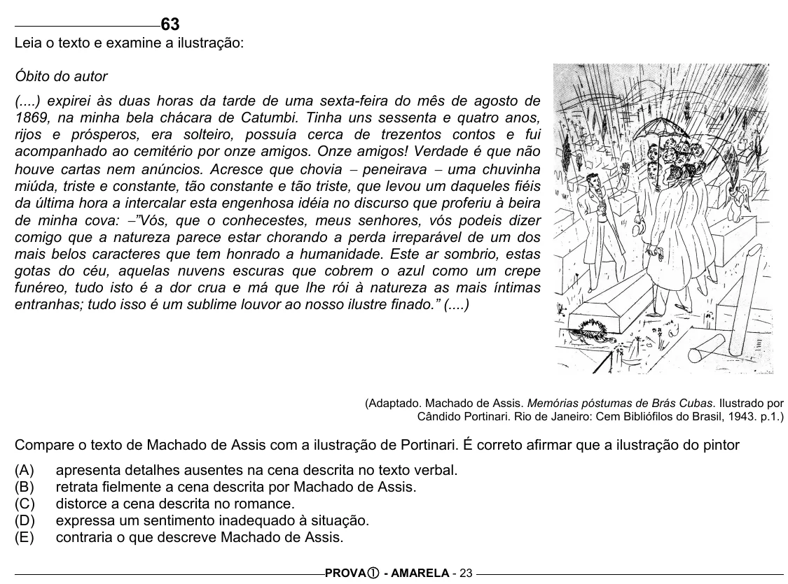

Texto extraído (pode conter ruído)

63  
Leia o texto e examine a ilustração:  
Óbito do autor  
(....) expirei às duas horas da tarde de uma sexta-feira do mês de agosto de  
1869, na minha bela chácara de Catumbi. Tinha uns sessenta e quatro anos,  
rijos e prósperos, era solteiro, possuía cerca de trezentos contos e fui  
acompanhado ao cemitério por onze amigos. Onze amigos! Verdade é que não  
houve cartas nem anúncios. Acresce que chovia − peneirava − uma chuvinha  
miúda, triste e constante, tão constante e tão triste, que levou um daqueles fiéis  
da última hora a intercalar esta engenhosa idéia no discurso que proferiu à beira  
de minha cova: − ”Vós, que o conhecestes, meus senhores, vós podeis dizer  
comigo que a natureza parece estar chorando a perda irreparável de um dos  
mais belos caracteres que tem honrado a humanidade. Este ar sombrio, estas  
gotas do céu, aquelas nuvens escuras que cobrem o azul como um crepe  
funéreo, tudo isto é a dor crua e má que lhe rói à natureza as mais íntimas  
entranhas; tudo isso é um sublime louvor ao nosso ilustre finado.” (....)  
(Adaptado. Machado de Assis. Memórias póstumas de Brás Cubas. Ilustrado por  
Cândido Portinari. Rio de Janeiro: Cem Bibliófilos do Brasil, 1943. p.1.)  
Compare o texto de Machado de Assis com a ilustração de Portinari. É correto afirmar que a ilustração do pintor  
(A)  
apresenta detalhes ausentes na cena descrita no texto verbal.  
(B)  
retrata fielmente a cena descrita por Machado de Assis.  
(C)  
distorce a cena descrita no romance.  
(D)  
expressa um sentimento inadequado à situação.  
(E)  
contraria o que descreve Machado de Assis.  
PROVA c - AMARELA - 23

