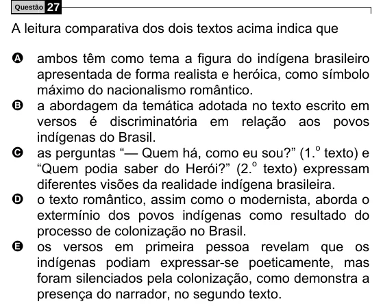

Texto extraído (pode conter ruído)

27  
Questão  
A leitura comparativa dos dois textos acima indica que  
A ambos têm como tema a figura do indígena brasileiro  
apresentada de forma realista e heróica, como símbolo  
máximo do nacionalismo romântico.  
B  
a abordagem da temática adotada no texto escrito em  
versos é discriminatória em relação aos povos  
indígenas do Brasil.  
as perguntas “— Quem há, como eu sou?” (1. o texto) e  
C  
“Quem podia saber do Herói?” (2. o texto) expressam  
diferentes visões da realidade indígena brasileira.  
D  
o texto romântico, assim como o modernista, aborda o  
extermínio dos povos indígenas como resultado do  
processo de colonização no Brasil.  
E  
os versos em primeira pessoa revelam que os  
indígenas podiam expressar-se poeticamente, mas  
foram silenciados pela colonização, como demonstra a  
presença do narrador, no segundo texto.

