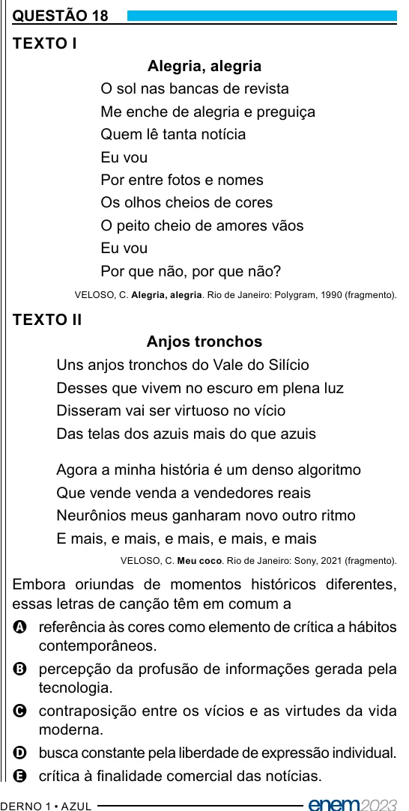

Texto extraído (pode conter ruído)

QUESTÃO 18  
TEXTO I  
Alegria, alegria  
O sol nas bancas de revista  
Me enche de alegria e preguiça  
Quem lê tanta notícia  
Eu vou  
Por entre fotos e nomes  
Os olhos cheios de cores  
O peito cheio de amores vãos  
Eu vou  
Por que não, por que não?  
VELOSO, C. Alegria, alegria. Rio de Janeiro: Polygram, 1990 (fragmento).  
TEXTO II  
Anjos tronchos  
Uns anjos tronchos do Vale do Silício  
Desses que vivem no escuro em plena luz  
Disseram vai ser virtuoso no vício  
Das telas dos azuis mais do que azuis  
Agora a minha história é um denso algoritmo  
Que vende venda a vendedores reais  
Neurônios meus ganharam novo outro ritmo  
E mais, e mais, e mais, e mais, e mais  
VELOSO, C. Meu coco. Rio de Janeiro: Sony, 2021 (fragmento).  
Embora oriundas de momentos históricos diferentes,  
essas letras de canção têm em comum a  
A referência às cores como elemento de crítica a hábitos  
contemporâneos.  
B percepção da profusão de informações gerada pela  
tecnologia.  
C contraposição entre os vícios e as virtudes da vida  
moderna.  
D busca constante pela liberdade de expressão individual.  
E crítica à finalidade comercial das notícias.

