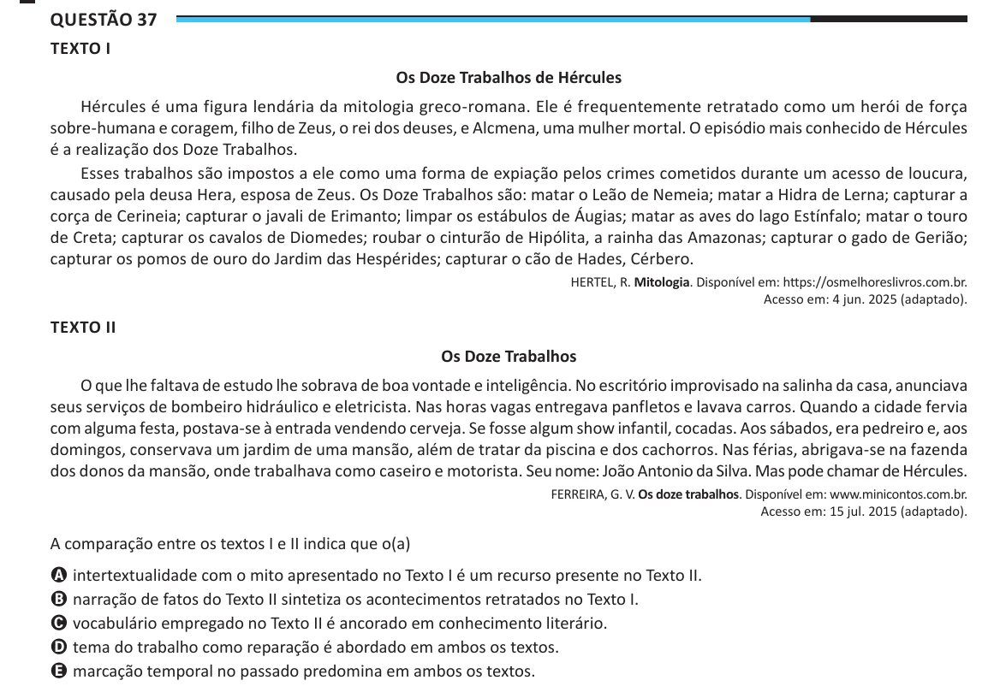

Texto extraído (pode conter ruído)

Questão 37  
TEXTO I  
Os Doze Trabalhos de Hércules  
Hércules é uma figura lendária da mitologia greco-romana. Ele é frequentemente retratado como um herói de força  
sobre-humana e coragem, filho de Zeus, o rei dos deuses, e Alcmena, uma mulher mortal. O episódio mais conhecido de Hércules  
é a realização dos Doze Trabalhos.  
Esses trabalhos são impostos a ele como uma forma de expiação pelos crimes cometidos durante um acesso de loucura,  
causado pela deusa Hera, esposa de Zeus. Os Doze Trabalhos são: matar o Leão de Nemeia; matar a Hidra de Lerna; capturar a  
corça de Cerineia; capturar o javali de Erimanto; limpar os estábulos de Áugias; matar as aves do lago Estínfalo; matar o touro  
de Creta; capturar os cavalos de Diomedes; roubar o cinturão de Hipólita, a rainha das Amazonas; capturar o gado de Gerião;  
capturar os pomos de ouro do Jardim das Hespérides; capturar o cão de Hades, Cérbero.  
HERTEL, R. Mitologia. Disponível em: https://osmelhoreslivros.com.br.  
Acesso em: 4 jun. 2025 (adaptado).  
TEXTO II  
Os Doze Trabalhos  
O que lhe faltava de estudo lhe sobrava de boa vontade e inteligência. No escritório improvisado na salinha da casa, anunciava  
seus serviços de bombeiro hidráulico e eletricista. Nas horas vagas entregava panfletos e lavava carros. Quando a cidade fervia  
com alguma festa, postava-se à entrada vendendo cerveja. Se fosse algum show infantil, cocadas. Aos sábados, era pedreiro e, aos  
domingos, conservava um jardim de uma mansão, além de tratar da piscina e dos cachorros. Nas férias, abrigava-se na fazenda  
dos donos da mansão, onde trabalhava como caseiro e motorista. Seu nome: João Antonio da Silva. Mas pode chamar de Hércules.  
FERREIRA, G. V. Os doze trabalhos. Disponível em: www.minicontos.com.br.  
Acesso em: 15 jul. 2015 (adaptado).  
A comparação entre os textos I e II indica que o(a)  
A intertextualidade com o mito apresentado no Texto I é um recurso presente no Texto II.  
B narração de fatos do Texto II sintetiza os acontecimentos retratados no Texto I.  
C vocabulário empregado no Texto II é ancorado em conhecimento literário.  
D tema do trabalho como reparação é abordado em ambos os textos.  
E marcação temporal no passado predomina em ambos os textos.

