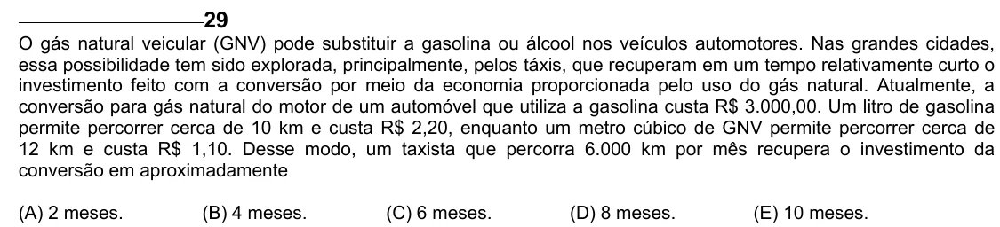

Texto extraído (pode conter ruído)

29  
O gás natural veicular (GNV) pode substituir a gasolina ou álcool nos veículos automotores. Nas grandes cidades,  
essa possibilidade tem sido explorada, principalmente, pelos táxis, que recuperam em um tempo relativamente curto o  
investimento feito com a conversão por meio da economia proporcionada pelo uso do gás natural. Atualmente, a  
conversão para gás natural do motor de um automóvel que utiliza a gasolina custa R$ 3.000,00. Um litro de gasolina  
permite percorrer cerca de 10 km e custa R$ 2,20, enquanto um metro cúbico de GNV permite percorrer cerca de  
12 km e custa R$ 1,10. Desse modo, um taxista que percorra 6.000 km por mês recupera o investimento da  
conversão em aproximadamente  
(A) 2 meses.  
(B) 4 meses.  
(C) 6 meses.  
(D) 8 meses.  
(E) 10 meses.

