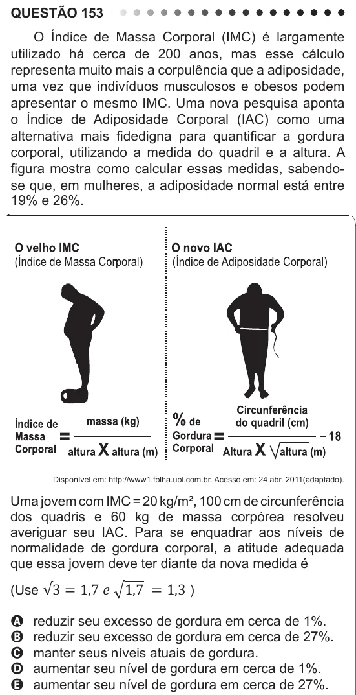

Texto extraído (pode conter ruído)

QUESTÃO 153  
O Índice de Massa Corporal (IMC) é largamente  
utilizado há cerca de 200 anos, mas esse cálculo  
representa muito mais a corpulência que a adiposidade,  
uma vez que indivíduos musculosos e obesos podem  
apresentar o mesmo IMC. Uma nova pesquisa aponta  
o Índice de Adiposidade Corporal (IAC) como uma  
alternativa mais fidedigna para quantificar a gordura  
corporal, utilizando a medida do quadril e a altura. A  
figura mostra como calcular essas medidas, sabendo-  
se que, em mulheres, a adiposidade normal está entre  
19% e 26%.  
Disponível em: http://www1.folha.uol.com.br. Acesso em: 24 abr. 2011(adaptado).  
Uma jovem com IMC = 20 kg/m², 100 cm de circunferência  
dos quadris e 60 kg de massa corpórea resolveu  
averiguar seu IAC. Para se enquadrar aos níveis de  
normalidade de gordura corporal, a atitude adequada  
que essa jovem deve ter diante da nova medida é  
(Use √3 � 1,7����1,7 � � 1,3 )  
reduzir seu excesso de gordura em cerca de 1%.  
A  
reduzir seu excesso de gordura em cerca de 27%.  
B  
manter seus níveis atuais de gordura.  
C  
aumentar seu nível de gordura em cerca de 1%.  
D  
aumentar seu nível de gordura em cerca de 27%.  
E

