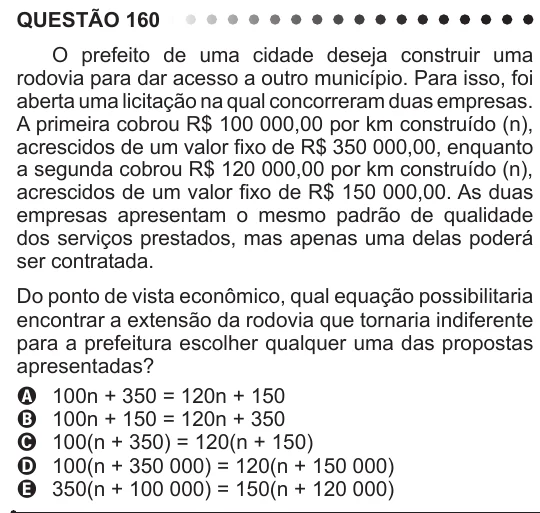

Texto extraído (pode conter ruído)

QUESTÃO 160  
O prefeito de uma cidade deseja construir uma  
rodovia para dar acesso a outro município. Para isso, foi  
aberta uma licitação na qual concorreram duas empresas.  
A primeira cobrou R$ 100 000,00 por km construído (n),  
acrescidos de um valor fixo de R$ 350 000,00, enquanto  
a segunda cobrou R$ 120 000,00 por km construído (n),  
acrescidos de um valor fixo de R$ 150 000,00. As duas  
empresas apresentam o mesmo padrão de qualidade  
dos serviços prestados, mas apenas uma delas poderá  
ser contratada.  
Do ponto de vista econômico, qual equação possibilitaria  
encontrar a extensão da rodovia que tornaria indiferente  
para a prefeitura escolher qualquer uma das propostas  
apresentadas?  
A 100n + 350 = 120n + 150  
B 100n + 150 = 120n + 350  
C 100(n + 350) = 120(n + 150)  
D 100(n + 350 000) = 120(n + 150 000)  
E 350(n + 100 000) = 150(n + 120 000)

