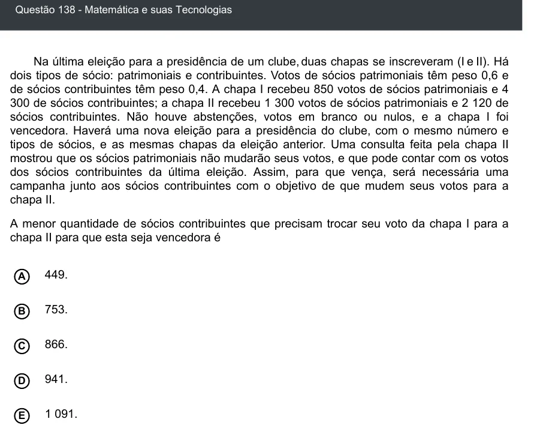

Texto extraído (pode conter ruído)

Questão 138 - Matemática e suas Tecnologias  
Na última eleição para a presidência de um clube, duas chapas se inscreveram (I e II). Há  
dois tipos de sócio: patrimoniais e contribuintes. Votos de sócios patrimoniais têm peso 0,6 e  
de sócios contribuintes têm peso 0,4. A chapa I recebeu 850 votos de sócios patrimoniais e 4  
300 de sócios contribuintes; a chapa II recebeu 1 300 votos de sócios patrimoniais e 2 120 de  
sócios contribuintes. Não houve abstenções, votos em branco ou nulos, e a chapa I foi  
vencedora. Haverá uma nova eleição para a presidência do clube, com o mesmo número e  
tipos de sócios, e as mesmas chapas da eleição anterior. Uma consulta feita pela chapa II  
mostrou que os sócios patrimoniais não mudarão seus votos, e que pode contar com os votos  
dos sócios contribuintes da última eleição. Assim, para que vença, será necessária uma  
campanha junto aos sócios contribuintes com o objetivo de que mudem seus votos para a  
chapa II.  
A menor quantidade de sócios contribuintes que precisam trocar seu voto da chapa I para a  
chapa II para que esta seja vencedora é  
A  
449.  
B  
753.  
866.  
C  
941.  
D  
E  
1 091.

