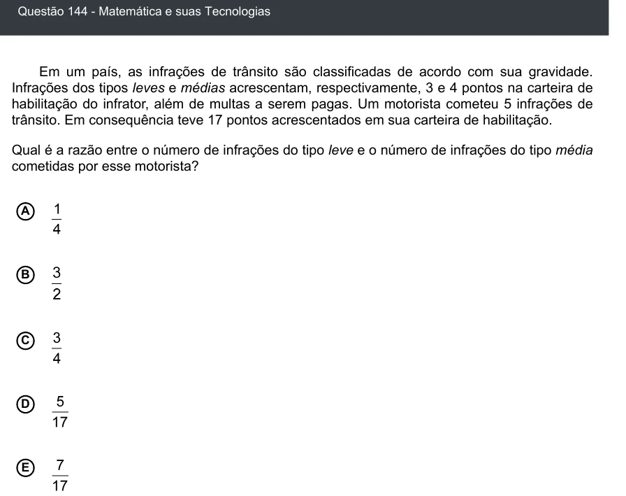

Texto extraído (pode conter ruído)

Questão 144 - Matemática e suas Tecnologias  
Em um país, as infrações de trânsito são classificadas de acordo com sua gravidade.  
Infrações dos tipos leves e médias acrescentam, respectivamente, 3 e 4 pontos na carteira de  
habilitação do infrator, além de multas a serem pagas. Um motorista cometeu 5 infrações de  
trânsito. Em consequência teve 17 pontos acrescentados em sua carteira de habilitação.  
Qual é a razão entre o número de infrações do tipo leve e o número de infrações do tipo média  
cometidas por esse motorista?  
A  
B  
C  
D  
E

