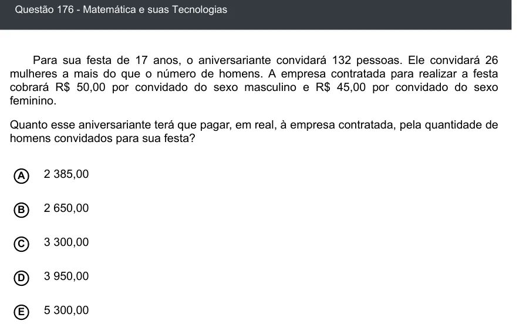

Texto extraído (pode conter ruído)

Questão 176 - Matemática e suas Tecnologias  
Para sua festa de 17 anos, o aniversariante convidará 132 pessoas. Ele convidará 26  
mulheres a mais do que o número de homens. A empresa contratada para realizar a festa  
cobrará R$ 50,00 por convidado do sexo masculino e R$ 45,00 por convidado do sexo  
feminino.  
Quanto esse aniversariante terá que pagar, em real, à empresa contratada, pela quantidade de  
homens convidados para sua festa?  
A  
2 385,00  
2 650,00  
B  
3 300,00  
C  
D  
3 950,00  
5 300,00  
E

