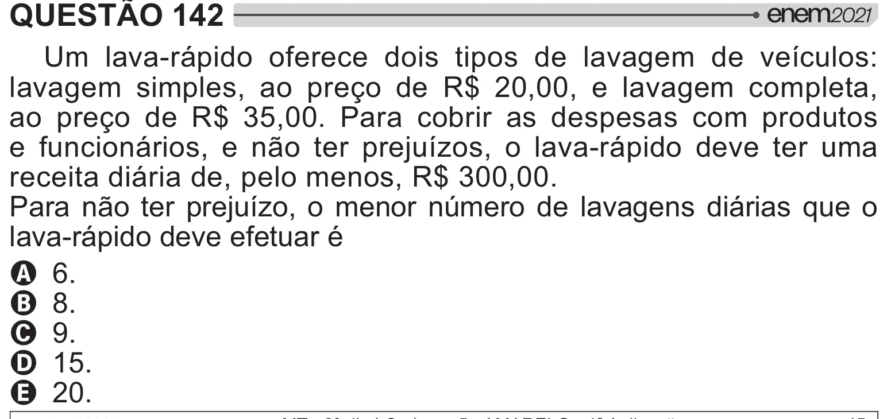

Texto extraído (pode conter ruído)

QUESTÃO 142  
Um lava-rápido oferece dois tipos de lavagem de veículos:  
lavagem simples, ao preço de R$ 20,00, e lavagem completa,  
ao preço de R$ 35,00. Para cobrir as despesas com produtos  
e funcionários, e não ter prejuízos, o lava-rápido deve ter uma  
receita diária de, pelo menos, R$ 300,00.  
Para não ter prejuízo, o menor número de lavagens diárias que o  
lava-rápido deve efetuar é  
A 6.  
B 8.  
C 9.  
D 15.  
E 20.

