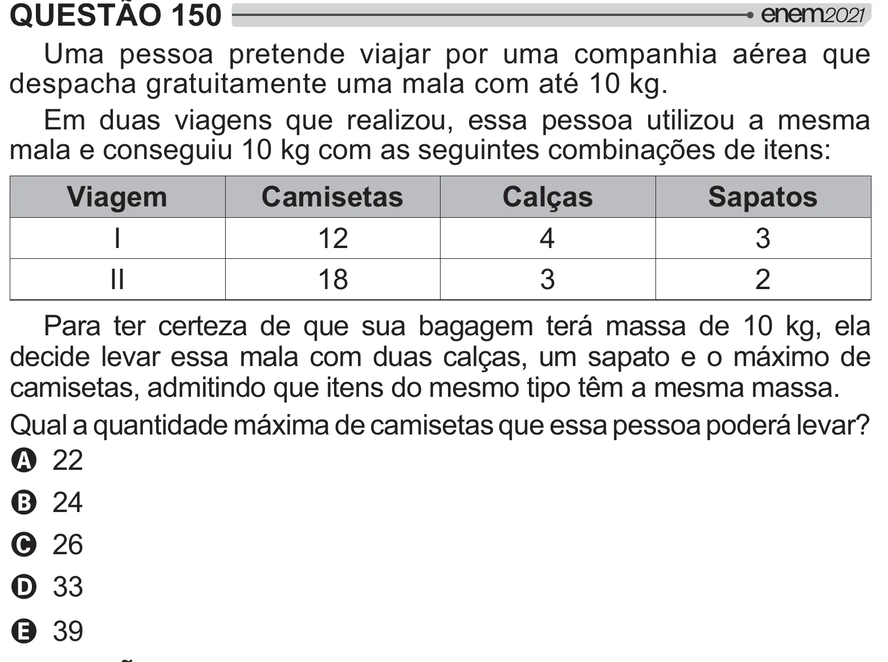

Texto extraído (pode conter ruído)

QUESTÃO 150  
Uma pessoa pretende viajar por uma companhia aérea que  
despacha gratuitamente uma mala com até 10 kg.  
Em duas viagens que realizou, essa pessoa utilizou a mesma  
mala e conseguiu 10 kg com as seguintes combinações de itens:  
Viagem  
Camisetas  
Calças  
Sapatos  
I  
12  
4  
3  
II  
18  
3  
2  
Para ter certeza de que sua bagagem terá massa de 10 kg, ela  
decide levar essa mala com duas calças, um sapato e o máximo de  
camisetas, admitindo que itens do mesmo tipo têm a mesma massa.  
&    /*     
 # # / "]  
A 22  
B 24  
C 26  
D 33  
E 39

