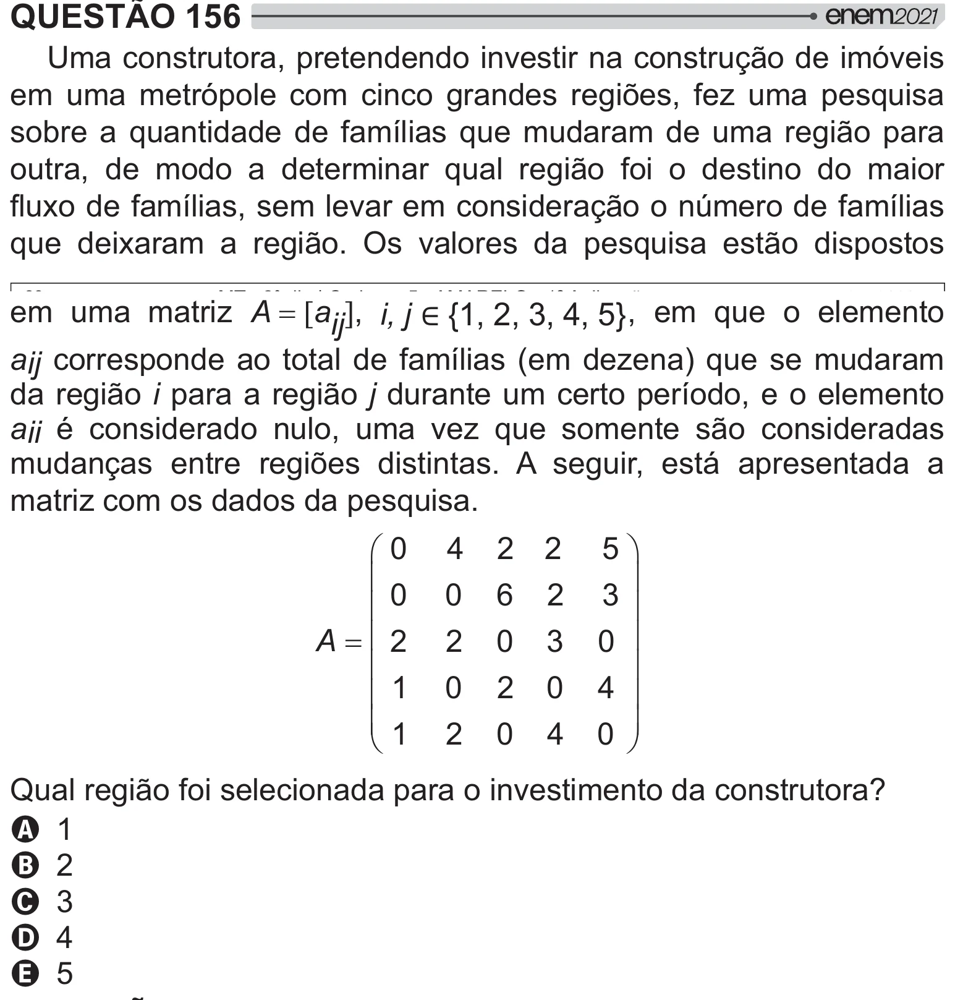

Texto extraído (pode conter ruído)

QUESTÃO 156  
Uma construtora, pretendendo investir na construção de imóveis  
em uma metrópole com cinco grandes regiões, fez uma pesquisa  
sobre a quantidade de famílias que mudaram de uma região para  
outra, de modo a determinar qual região foi o destino do maior  
} * >{   "   =[„  >{   
  *   [!   "   #  
   
[  #    
em uma matriz A >aij @ , i, j º`‘®» , em que o elemento  
aij corresponde ao total de famílias (em dezena) que se mudaram  
da região i para a região j durante um certo período, e o elemento  
aii é considerado nulo, uma vez que somente são consideradas  
mudanças entre regiões distintas. A seguir, está apresentada a  
matriz com os dados da pesquisa.  
§ 0  
5 ·  
4  
2 2  
¨  
¸  
¨ 0  
0  
6 2  
3 ¸  
¨ 2  
0 ¸  
A  
2  
0 3  
¨  
¸  
¨ 1  
0  
2 0  
4 ¸  
¨ 1  
0 ¸ ¹  
©  
2  
0 4  
&  [>  
 #"  
    ]  
A 1  
B 2  
C 3  
D 4  
E 5

