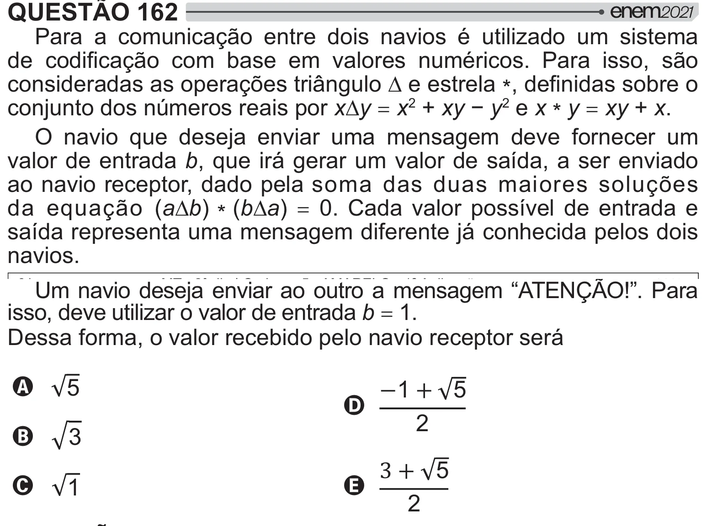

Texto extraído (pode conter ruído)

QUESTÃO 162  
Para a comunicação entre dois navios é utilizado um sistema  
  =[  y   "   < !    [  
    # =  ­ ¯   *   y   
conjunto dos números reais por x¯y = x ” + xyy 2 e x * y = xy + x.  
O navio que deseja enviar uma mensagem deve fornecer um  
valor de entrada b, que irá gerar um valor de saída, a ser enviado  
ao navio receptor, dado pela soma das duas maiores soluções  
da equação (a¯b) * (b¯a) = 0. Cada valor possível de entrada e  
saída representa uma mensagem diferente já conhecida pelos dois  
navios.  
Um navio deseja enviar ao outro a mensagem “ATENÇÃO!”. Para  
isso, deve utilizar o valor de entrada b = 1.  
Dessa forma, o valor recebido pelo navio receptor será  
A  
`    
  
D  
‘  
B  
®  
   
C  
E  
`  
‘

