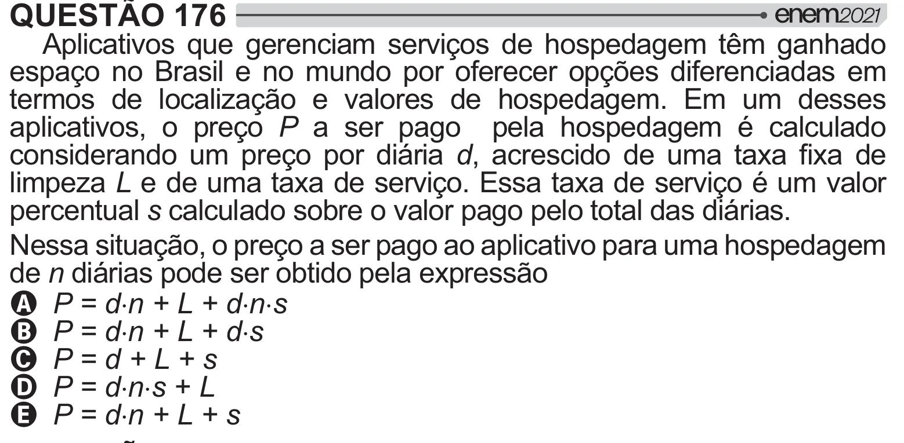

Texto extraído (pode conter ruído)

QUESTÃO 176  
Aplicativos que gerenciam serviços de hospedagem têm ganhado  
espaço no Brasil e no mundo por oferecer opções diferenciadas em  
termos de localização e valores de hospedagem. Em um desses  
aplicativos, o preço P a ser pago pela hospedagem é calculado  
considerando um preço por diária d      * *    
limpeza L e de uma taxa de serviço. Essa taxa de serviço é um valor  
percentual s calculado sobre o valor pago pelo total das diárias.  
Nessa situação, o preço a ser pago ao aplicativo para uma hospedagem  
de n diárias pode ser obtido pela expressão  
A P = d˜n + L + d˜n˜s  
B P = d˜n + L + d˜s  
C P = d + L + s  
D P = d˜n˜s + L  
E P = d˜n + L + s

