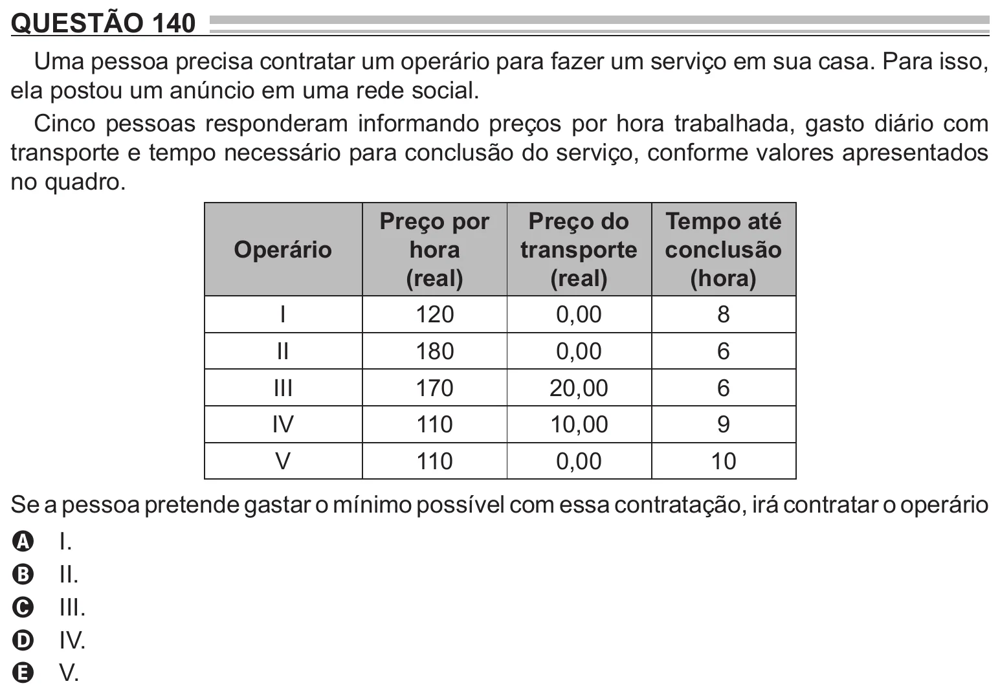

Texto extraído (pode conter ruído)

QUESTÃO 140  
Uma pessoa precisa contratar um operário para fazer um serviço em sua casa. Para isso,  
ela postou um anúncio em uma rede social.  
Cinco pessoas responderam informando preços por hora trabalhada, gasto diário com  
transporte e tempo necessário para conclusão do serviço, conforme valores apresentados  
no quadro.  
Preço por  
Preço do  
Tempo até  
Operário  
hora  
transporte  
conclusão  
(real)  
(real)  
(hora)  
I  
120  
0,00  
8  
II  
180  
0,00  
6  
III  
170  
20,00  
6  
IV  
110  
10,00  
9  
V  
110  
0,00  
10  
Se a pessoa pretende gastar o mínimo possível com essa contratação, irá contratar o operário  
I.  
A  
II.  
B  
III.  
C  
IV.  
D  
V.  
E

