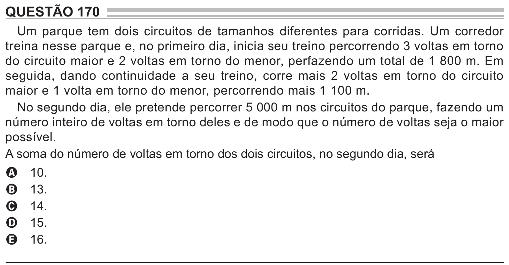

Texto extraído (pode conter ruído)

QUESTÃO 170  
Um parque tem dois circuitos de tamanhos diferentes para corridas. Um corredor  
treina nesse parque e, no primeiro dia, inicia seu treino percorrendo 3 voltas em torno  
do circuito maior e 2 voltas em torno do menor, perfazendo um total de 1 800 m. Em  
seguida, dando continuidade a seu treino, corre mais 2 voltas em torno do circuito  
maior e 1 volta em torno do menor, percorrendo mais 1 100 m.  
No segundo dia, ele pretende percorrer 5 000 m nos circuitos do parque, fazendo um  
número inteiro de voltas em torno deles e de modo que o número de voltas seja o maior  
possível.  
A soma do número de voltas em torno dos dois circuitos, no segundo dia, será  
10.  
A  
13.  
B  
14.  
C  
15.  
D  
16.  
E

