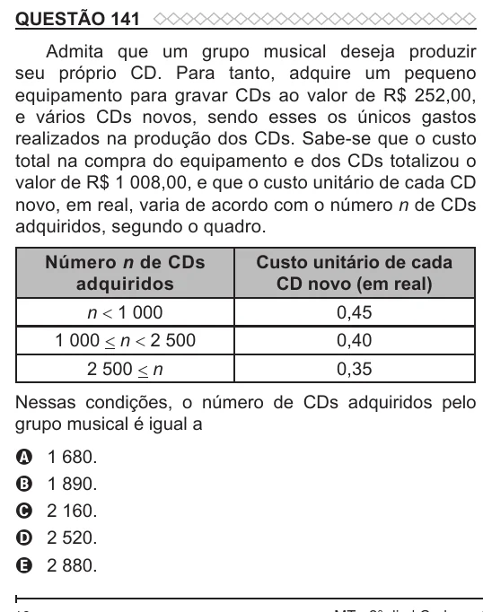

Texto extraído (pode conter ruído)

QUESTÃO 141  
Admita que um grupo musical deseja produzir  
seu próprio CD. Para tanto, adquire um pequeno  
equipamento para gravar CDs ao valor de R$ 252,00,  
e vários CDs novos, sendo esses os únicos gastos  
realizados na produção dos CDs. Sabe-se que o custo  
total na compra do equipamento e dos CDs totalizou o  
valor de R$ 1 008,00, e que o custo unitário de cada CD  
novo, em real, varia de acordo com o número n de CDs  
adquiridos, segundo o quadro.  
Número n de CDs  
Custo unitário de cada  
adquiridos  
CD novo (em real)  
n < 1 000  
0,45  
1 000 < n < 2 500  
0,40  
2 500 < n  
0,35  
Nessas condições, o número de CDs adquiridos pelo  
grupo musical é igual a  
A  
1 680.  
B  
1 890.  
2 160.  
C  
2 520.  
D  
2 880.  
E

