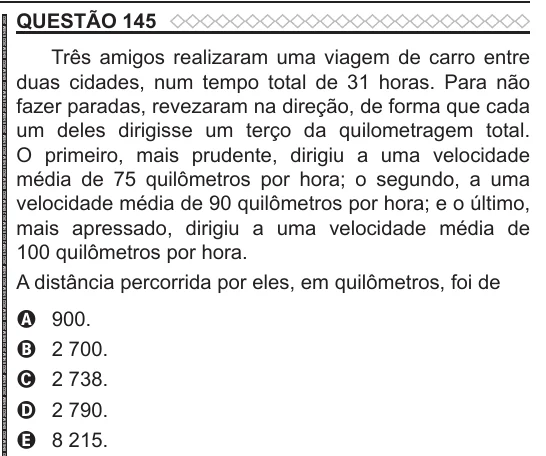

Texto extraído (pode conter ruído)

QUESTÃO 145  
Três amigos realizaram uma viagem de carro entre  
duas cidades, num tempo total de 31 horas. Para não  
fazer paradas, revezaram na direção, de forma que cada  
um deles dirigisse um terço da quilometragem total.  
O primeiro, mais prudente, dirigiu a uma velocidade  
média de 75 quilômetros por hora; o segundo, a uma  
velocidade média de 90 quilômetros por hora; e o último,  
mais apressado, dirigiu a uma velocidade média de  
100 quilômetros por hora.  
A distância percorrida por eles, em quilômetros, foi de  
900.  
A  
2 700.  
B  
2 738.  
C  
2 790.  
D  
E  
8 215.

