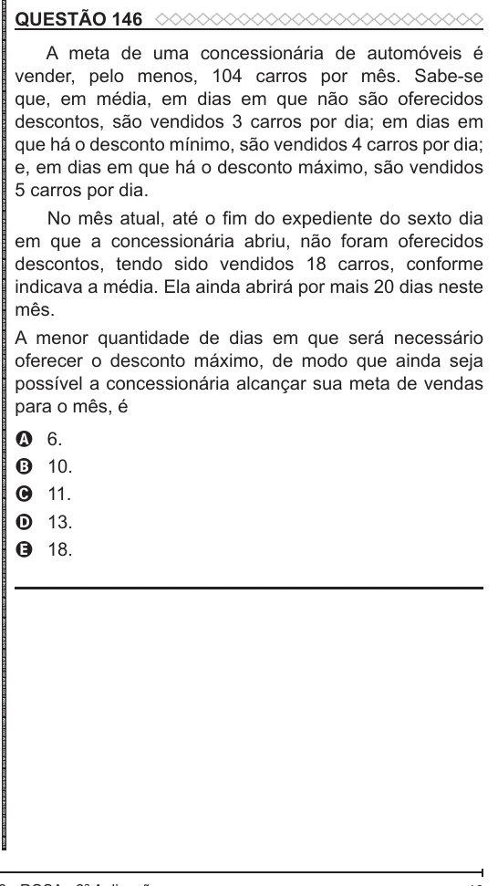

Texto extraído (pode conter ruído)

QUESTÃO 146  
A meta de uma concessionária de automóveis é  
vender, pelo menos, 104 carros por mês. Sabe-se  
que, em média, em dias em que não são oferecidos  
descontos, são vendidos 3 carros por dia; em dias em  
que há o desconto mínimo, são vendidos 4 carros por dia;  
e, em dias em que há o desconto máximo, são vendidos  
5 carros por dia.  
No mês atual, até o fim do expediente do sexto dia  
em que a concessionária abriu, não foram oferecidos  
descontos, tendo sido vendidos 18 carros, conforme  
indicava a média. Ela ainda abrirá por mais 20 dias neste  
mês.  
A menor quantidade de dias em que será necessário  
oferecer o desconto máximo, de modo que ainda seja  
possível a concessionária alcançar sua meta de vendas  
para o mês, é  
6.  
A  
10.  
B  
C  
11.  
D  
13.  
18.  
E

