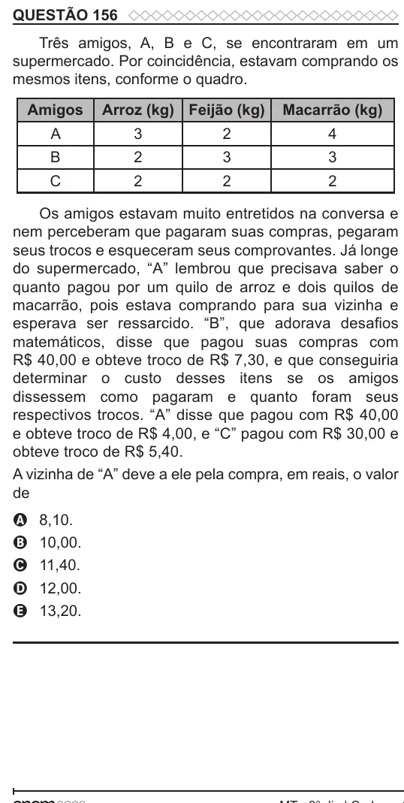

Texto extraído (pode conter ruído)

QUESTÃO 156  
Três amigos, A, B e C, se encontraram em um  
supermercado. Por coincidência, estavam comprando os  
mesmos itens, conforme o quadro.  
Amigos  
Arroz (kg) Feijão (kg)  
Macarrão (kg)  
A  
3  
2  
4  
B  
2  
3  
3  
C  
2  
2  
2  
Os amigos estavam muito entretidos na conversa e  
nem perceberam que pagaram suas compras, pegaram  
seus trocos e esqueceram seus comprovantes. Já longe  
do supermercado, “A” lembrou que precisava saber o  
quanto pagou por um quilo de arroz e dois quilos de  
macarrão, pois estava comprando para sua vizinha e  
esperava ser ressarcido. “B”, que adorava desafios  
matemáticos, disse que pagou suas compras com  
R$ 40,00 e obteve troco de R$ 7,30, e que conseguiria  
determinar o custo desses itens se os amigos  
dissessem como pagaram e quanto foram seus  
respectivos trocos. “A” disse que pagou com R$ 40,00  
e obteve troco de R$ 4,00, e “C” pagou com R$ 30,00 e  
obteve troco de R$ 5,40.  
A vizinha de “A” deve a ele pela compra, em reais, o valor  
de  
8,10.  
A  
10,00.  
B  
11,40.  
C  
12,00.  
D  
E  
13,20.

