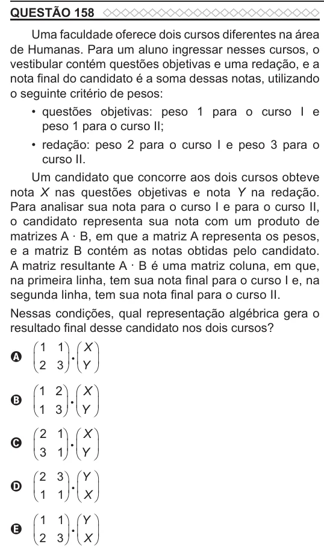

Texto extraído (pode conter ruído)

QUESTÃO 158  
Uma faculdade oferece dois cursos diferentes na área  
de Humanas. Para um aluno ingressar nesses cursos, o  
vestibular contém questões objetivas e uma redação, e a  
nota final do candidato é a soma dessas notas, utilizando  
o seguinte critério de pesos:  
• questões objetivas: peso 1 para o curso I e  
peso 1 para o curso II;  
• redação: peso 2 para o curso I e peso 3 para o  
curso II.  
Um candidato que concorre aos dois cursos obteve  
nota X nas questões objetivas e nota Y na redação.  
Para analisar sua nota para o curso I e para o curso II,  
o candidato representa sua nota com um produto de  
matrizes A . B, em que a matriz A representa os pesos,  
e a matriz B contém as notas obtidas pelo candidato.  
A matriz resultante A . B é uma matriz coluna, em que,  
na primeira linha, tem sua nota final para o curso I e, na  
segunda linha, tem sua nota final para o curso II.  
Nessas condições, qual representação algébrica gera o  
resultado final desse candidato nos dois cursos?  
 1 1   X   
       
A   
 2 3   Y   
 1 2   X   
B   
       
 1 3   Y   
 2 1   X   
       
C   
 3 1   Y   
 2 3   Y   
       
D   
 1 1   X   
 1 1   Y   
       
E   
 2 3   X

