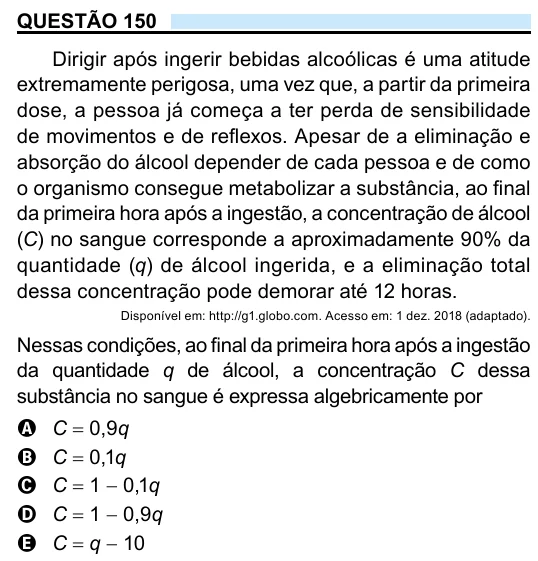

Texto extraído (pode conter ruído)

QUESTÃO 150  
Dirigir após ingerir bebidas alcoólicas é uma atitude  
extremamente perigosa, uma vez que, a partir da primeira  
dose, a pessoa já começa a ter perda de sensibilidade  
de movimentos e de reflexos. Apesar de a eliminação e  
absorção do álcool depender de cada pessoa e de como  
o organismo consegue metabolizar a substância, ao final  
da primeira hora após a ingestão, a concentração de álcool  
(C) no sangue corresponde a aproximadamente 90% da  
quantidade (q) de álcool ingerida, e a eliminação total  
dessa concentração pode demorar até 12 horas.  
Disponível em: http://g1.globo.com. Acesso em: 1 dez. 2018 (adaptado).  
Nessas condições, ao final da primeira hora após a ingestão  
da quantidade q de álcool, a concentração C dessa  
substância no sangue é expressa algebricamente por  
C = 0,9q  
A  
C = 0,1q  
B  
C = 1 − 0,1q  
C  
D  
C = 1 − 0,9q  
C = q − 10  
E

