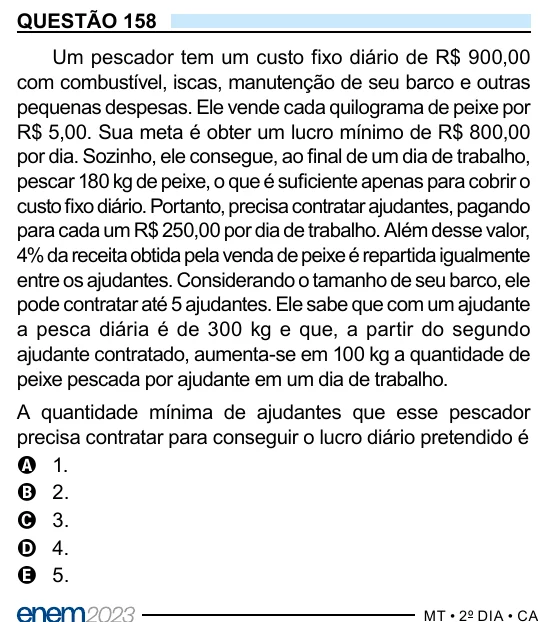

Texto extraído (pode conter ruído)

QUESTÃO 158  
Um pescador tem um custo fixo diário de R$ 900,00  
com combustível, iscas, manutenção de seu barco e outras  
pequenas despesas. Ele vende cada quilograma de peixe por  
R$ 5,00. Sua meta é obter um lucro mínimo de R$ 800,00  
por dia. Sozinho, ele consegue, ao final de um dia de trabalho,  
pescar 180 kg de peixe, o que é suficiente apenas para cobrir o  
custo fixo diário. Portanto, precisa contratar ajudantes, pagando  
para cada um R$ 250,00 por dia de trabalho. Além desse valor,  
4% da receita obtida pela venda de peixe é repartida igualmente  
entre os ajudantes. Considerando o tamanho de seu barco, ele  
pode contratar até 5 ajudantes. Ele sabe que com um ajudante  
a pesca diária é de 300 kg e que, a partir do segundo  
ajudante contratado, aumenta-se em 100 kg a quantidade de  
peixe pescada por ajudante em um dia de trabalho.  
A quantidade mínima de ajudantes que esse pescador  
precisa contratar para conseguir o lucro diário pretendido é  
A 1.  
B 2.  
C 3.  
D 4.  
E 5.

