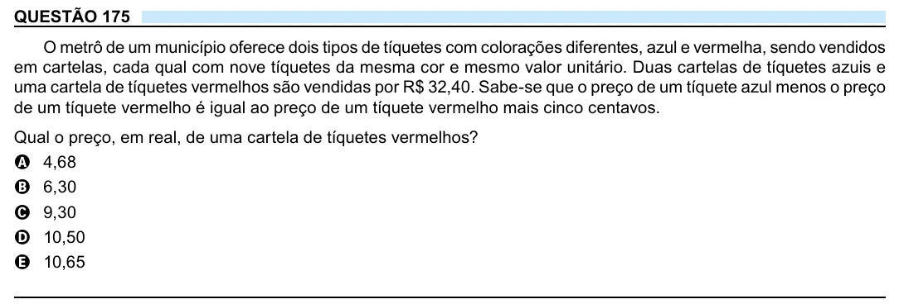

Texto extraído (pode conter ruído)

QUESTÃO 175  
O metrô de um município oferece dois tipos de tíquetes com colorações diferentes, azul e vermelha, sendo vendidos  
em cartelas, cada qual com nove tíquetes da mesma cor e mesmo valor unitário. Duas cartelas de tíquetes azuis e  
uma cartela de tíquetes vermelhos são vendidas por R$ 32,40. Sabe-se que o preço de um tíquete azul menos o preço  
de um tíquete vermelho é igual ao preço de um tíquete vermelho mais cinco centavos.  
Qual o preço, em real, de uma cartela de tíquetes vermelhos?  
A 4,68  
B 6,30  
C 9,30  
D 10,50  
E 10,65

