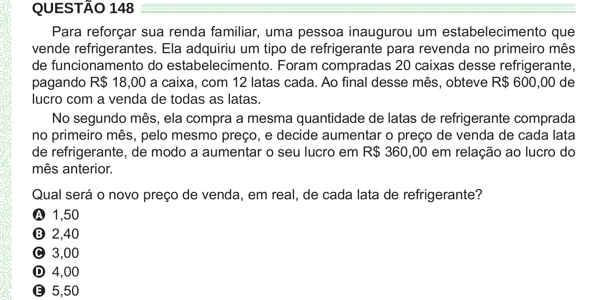

Texto extraído (pode conter ruído)

QUESTÃO 148  
Para reforçar sua renda familiar, uma pessoa inaugurou um estabelecimento que  
vende refrigerantes. Ela adquiriu um tipo de refrigerante para revenda no primeiro mês  
de funcionamento do estabelecimento. Foram compradas 20 caixas desse refrigerante,  
pagando R$ 18,00 a caixa, com 12 latas cada. Ao final desse mês, obteve R$ 600,00 de  
lucro com a venda de todas as latas.  
No segundo mês, ela compra a mesma quantidade de latas de refrigerante comprada  
no primeiro mês, pelo mesmo preço, e decide aumentar o preço de venda de cada lata  
de refrigerante, de modo a aumentar o seu lucro em R$ 360,00 em relação ao lucro do  
mês anterior.  
Qual será o novo preço de venda, em real, de cada lata de refrigerante?  
A 1,50  
B 2,40  
C 3,00  
D 4,00  
E 5,50

