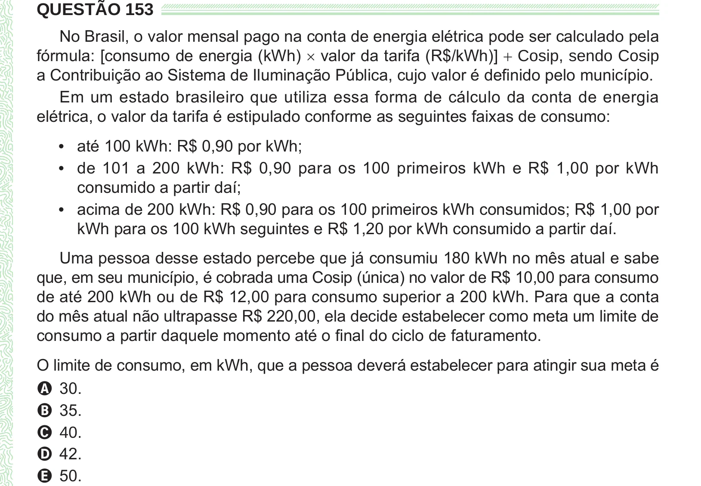

Texto extraído (pode conter ruído)

QUESTÃO 153  
No Brasil, o valor mensal pago na conta de energia elétrica pode ser calculado pela  
fórmula: [consumo de energia (kWh) × valor da tarifa (R$/kWh)] + Cosip, sendo Cosip  
a Contribuição ao Sistema de Iluminação Pública, cujo valor é definido pelo município.  
Em um estado brasileiro que utiliza essa forma de cálculo da conta de energia  
elétrica, o valor da tarifa é estipulado conforme as seguintes faixas de consumo:  
• até 100 kWh: R$ 0,90 por kWh;  
• de 101 a 200 kWh: R$ 0,90 para os 100 primeiros kWh e R$ 1,00 por kWh  
consumido a partir daí;  
• acima de 200 kWh: R$ 0,90 para os 100 primeiros kWh consumidos; R$ 1,00 por  
kWh para os 100 kWh seguintes e R$ 1,20 por kWh consumido a partir daí.  
Uma pessoa desse estado percebe que já consumiu 180 kWh no mês atual e sabe  
que, em seu município, é cobrada uma Cosip (única) no valor de R$ 10,00 para consumo  
de até 200 kWh ou de R$ 12,00 para consumo superior a 200 kWh. Para que a conta  
do mês atual não ultrapasse R$ 220,00, ela decide estabelecer como meta um limite de  
consumo a partir daquele momento até o final do ciclo de faturamento.  
O limite de consumo, em kWh, que a pessoa deverá estabelecer para atingir sua meta é  
A 30.  
B 35.  
C 40.  
D 42.  
E 50.

