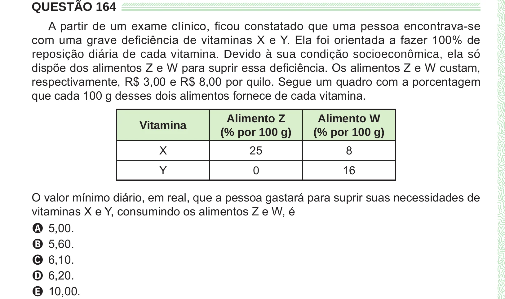

Texto extraído (pode conter ruído)

QUESTÃO 164  
A partir de um exame clínico, ficou constatado que uma pessoa encontrava-se  
com uma grave deficiência de vitaminas X e Y. Ela foi orientada a fazer 100% de  
reposição diária de cada vitamina. Devido à sua condição socioeconômica, ela só  
dispõe dos alimentos Z e W para suprir essa deficiência. Os alimentos Z e W custam,  
respectivamente, R$ 3,00 e R$ 8,00 por quilo. Segue um quadro com a porcentagem  
que cada 100 g desses dois alimentos fornece de cada vitamina.  
Alimento Z  
Alimento W  
Vitamina  
(% por 100 g)  
(% por 100 g)  
X  
25  
8  
Y  
16  
0  
O valor mínimo diário, em real, que a pessoa gastará para suprir suas necessidades de  
vitaminas X e Y, consumindo os alimentos Z e W, é  
A 5,00.  
B 5,60.  
C 6,10.  
D 6,20.  
E 10,00.

