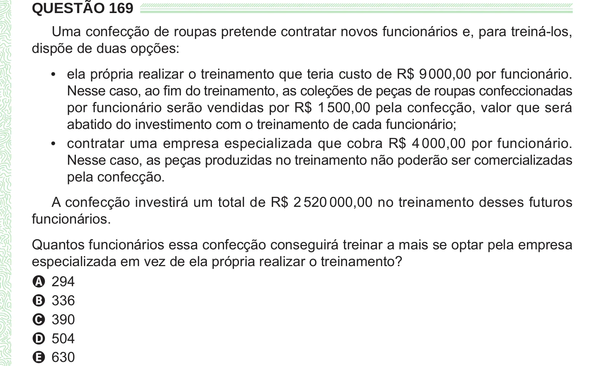

Texto extraído (pode conter ruído)

QUESTÃO 169  
Uma confecção de roupas pretende contratar novos funcionários e, para treiná-los,  
dispõe de duas opções:  
• ela própria realizar o treinamento que teria custo de R$ 9 000,00 por funcionário.  
Nesse caso, ao fim do treinamento, as coleções de peças de roupas confeccionadas  
por funcionário serão vendidas por R$ 1 500,00 pela confecção, valor que será  
abatido do investimento com o treinamento de cada funcionário;  
• contratar uma empresa especializada que cobra R$ 4 000,00 por funcionário.  
Nesse caso, as peças produzidas no treinamento não poderão ser comercializadas  
pela confecção.  
A confecção investirá um total de R$ 2 520 000,00 no treinamento desses futuros  
funcionários.  
Quantos funcionários essa confecção conseguirá treinar a mais se optar pela empresa  
especializada em vez de ela própria realizar o treinamento?  
A 294  
B 336  
C 390  
D 504  
E 630

