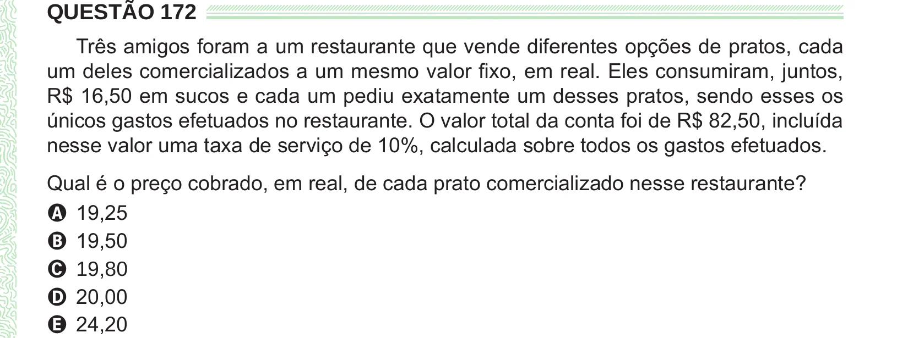

Texto extraído (pode conter ruído)

QUESTÃO 172  
Três amigos foram a um restaurante que vende diferentes opções de pratos, cada  
um deles comercializados a um mesmo valor fixo, em real. Eles consumiram, juntos,  
R$ 16,50 em sucos e cada um pediu exatamente um desses pratos, sendo esses os  
únicos gastos efetuados no restaurante. O valor total da conta foi de R$ 82,50, incluída  
nesse valor uma taxa de serviço de 10%, calculada sobre todos os gastos efetuados.  
Qual é o preço cobrado, em real, de cada prato comercializado nesse restaurante?  
A 19,25  
B 19,50  
C 19,80  
D 20,00  
E 24,20

