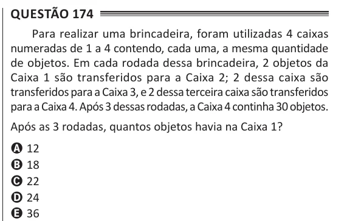

Texto extraído (pode conter ruído)

Questão 174  
Para realizar uma brincadeira, foram utilizadas 4 caixas  
numeradas de 1 a 4 contendo, cada uma, a mesma quantidade  
de objetos. Em cada rodada dessa brincadeira, 2 objetos da  
Caixa 1 são transferidos para a Caixa 2; 2 dessa caixa são  
transferidos para a Caixa 3, e 2 dessa terceira caixa são transferidos  
para a Caixa 4. Após 3 dessas rodadas, a Caixa 4 continha 30 objetos.  
Após as 3 rodadas, quantos objetos havia na Caixa 1?  
A 12  
B 18  
C 22  
D 24  
E 36

