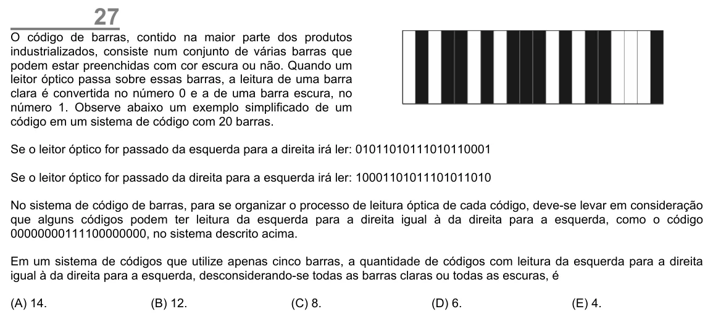

Texto extraído (pode conter ruído)

27  
O código de barras, contido na maior parte dos produtos  
industrializados, consiste num conjunto de várias barras que  
podem estar preenchidas com cor escura ou não. Quando um  
leitor óptico passa sobre essas barras, a leitura de uma barra  
clara é convertida no número 0 e a de uma barra escura, no  
número 1. Observe abaixo um exemplo simplificado de um  
código em um sistema de código com 20 barras.  
Se o leitor óptico for passado da esquerda para a direita irá ler: 01011010111010110001  
Se o leitor óptico for passado da direita para a esquerda irá ler: 10001101011101011010  
No sistema de código de barras, para se organizar o processo de leitura óptica de cada código, deve-se levar em consideração  
que alguns códigos podem ter leitura da esquerda para a direita igual à da direita para a esquerda, como o código  
00000000111100000000, no sistema descrito acima.  
Em um sistema de códigos que utilize apenas cinco barras, a quantidade de códigos com leitura da esquerda para a direita  
igual à da direita para a esquerda, desconsiderando-se todas as barras claras ou todas as escuras, é  
(A) 14.  
(B) 12.  
(C) 8.  
(D) 6.  
(E) 4.

