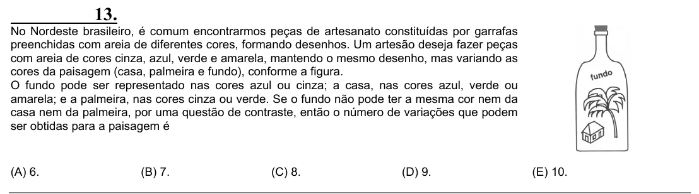

Texto extraído (pode conter ruído)

13.  
No Nordeste brasileiro, é comum encontrarmos peças de artesanato constituídas por garrafas  
preenchidas com areia de diferentes cores, formando desenhos. Um artesão deseja fazer peças  
com areia de cores cinza, azul, verde e amarela, mantendo o mesmo desenho, mas variando as  
cores da paisagem (casa, palmeira e fundo), conforme a figura.  
O fundo pode ser representado nas cores azul ou cinza; a casa, nas cores azul, verde ou  
amarela; e a palmeira, nas cores cinza ou verde. Se o fundo não pode ter a mesma cor nem da  
casa nem da palmeira, por uma questão de contraste, então o número de variações que podem  
ser obtidas para a paisagem é  
(A) 6.  
(B) 7.  
(C) 8.  
(D) 9.  
(E) 10.

