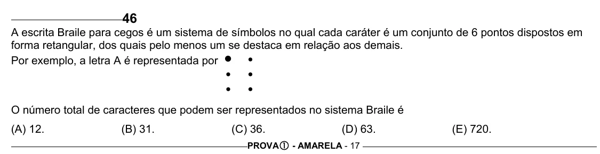

Texto extraído (pode conter ruído)

46  
A escrita Braile para cegos é um sistema de símbolos no qual cada caráter é um conjunto de 6 pontos dispostos em  
forma retangular, dos quais pelo menos um se destaca em relação aos demais.  
Por exemplo, a letra A é representada por y y  
y  
y  
y  
y  
O número total de caracteres que podem ser representados no sistema Braile é  
(A) 12.  
(B) 31.  
(C) 36.  
(D) 63.  
(E) 720.  
PROVA c - AMARELA - 17

