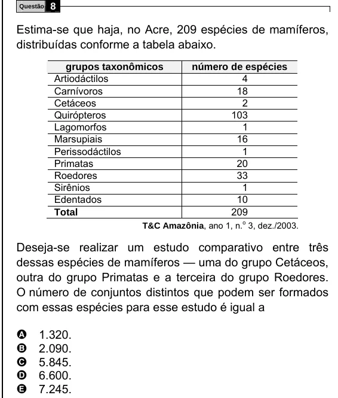

Texto extraído (pode conter ruído)

Questão  
8  
Estima-se que haja, no Acre, 209 espécies de mamíferos,  
distribuídas conforme a tabela abaixo.  
grupos taxonômicos  
número de espécies  
Artiodáctilos  
4  
Carnívoros  
18  
Cetáceos  
2  
Quirópteros  
103  
Lagomorfos  
1  
Marsupiais  
16  
Perissodáctilos  
1  
Primatas  
20  
Roedores  
33  
Sirênios  
1  
Edentados  
10  
209  
Total  
T&C Amazônia, ano 1, n. o 3, dez./2003.  
Deseja-se realizar um estudo comparativo entre três  
dessas espécies de mamíferos — uma do grupo Cetáceos,  
outra do grupo Primatas e a terceira do grupo Roedores.  
O número de conjuntos distintos que podem ser formados  
com essas espécies para esse estudo é igual a  
A  
1.320.  
2.090.  
B  
C  
5.845.  
D  
6.600.  
7.245.  
E

