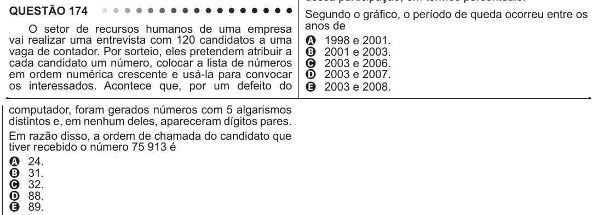

Texto extraído (pode conter ruído)

QUESTÃO 174  
Segundo o gráfico, o período de queda ocorreu entre os  
anos de  
O setor de recursos humanos de uma empresa  
vai realizar uma entrevista com 120 candidatos a uma  
A 1998 e 2001.  
vaga de contador. Por sorteio, eles pretendem atribuir a  
B 2001 e 2003.  
cada candidato um número, colocar a lista de números  
C 2003 e 2006.  
em ordem numérica crescente e usá-la para convocar  
D 2003 e 2007.  
os interessados. Acontece que, por um defeito do  
E 2003 e 2008.  
computador, foram gerados números com 5 algarismos  
distintos e, em nenhum deles, apareceram dígitos pares.  
Em razão disso, a ordem de chamada do candidato que  
tiver recebido o número 75 913 é  
A 24.  
B 31.  
C 32.  
D 88.  
E 89.

