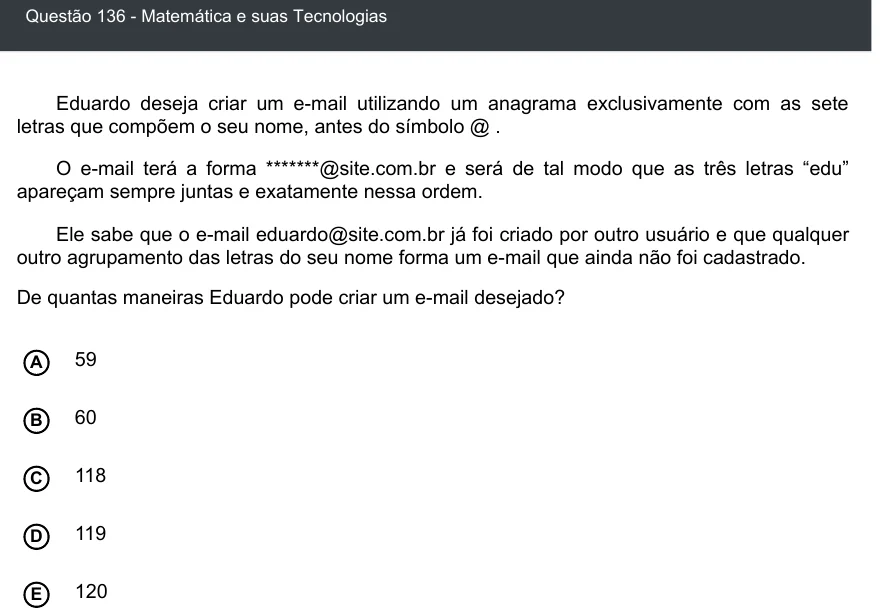

Texto extraído (pode conter ruído)

Questão 136 - Matemática e suas Tecnologias  
Eduardo deseja criar um e-mail utilizando um anagrama exclusivamente com as sete  
letras que compõem o seu nome, antes do símbolo @ .  
O e-mail terá a forma *******@site.com.br e será de tal modo que as três letras “edu”  
apareçam sempre juntas e exatamente nessa ordem.  
Ele sabe que o e-mail eduardo@site.com.br já foi criado por outro usuário e que qualquer  
outro agrupamento das letras do seu nome forma um e-mail que ainda não foi cadastrado.  
De quantas maneiras Eduardo pode criar um e-mail desejado?  
A  
59  
60  
B  
118  
C  
D  
119  
E  
120

