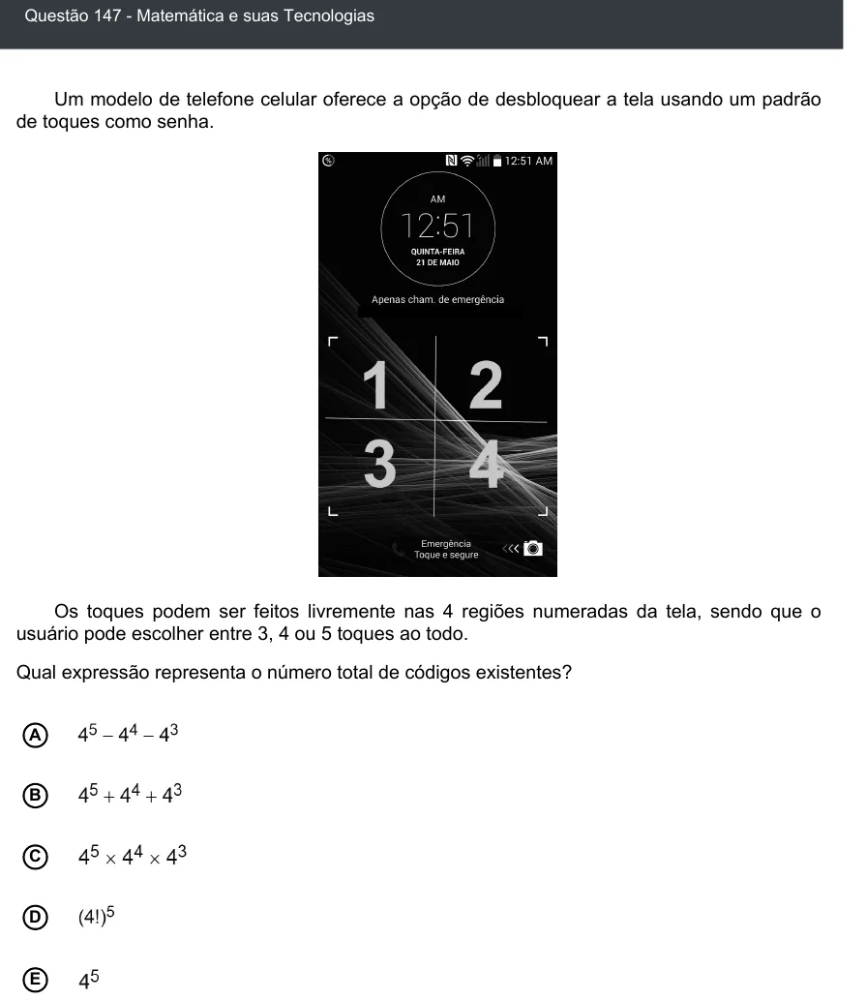

Texto extraído (pode conter ruído)

Questão 147 - Matemática e suas Tecnologias  
Um modelo de telefone celular oferece a opção de desbloquear a tela usando um padrão  
de toques como senha.  
Os toques podem ser feitos livremente nas 4 regiões numeradas da tela, sendo que o  
usuário pode escolher entre 3, 4 ou 5 toques ao todo.  
Qual expressão representa o número total de códigos existentes?  
A  
B  
C  
D  
E

